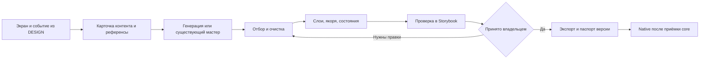

# Chewy — производство контента

> 29 октября 2026. Предложение пайплайна для ревью владельцем.
> Действующие продуктовые правила — [DESIGN](DESIGN.md), очередь — [TODO](TODO.md),
> существующие файлы и происхождение — [ASSETS](ASSETS.md).
> Этот план не утверждает финальный арт, реплики, новые механики или расширение каталога.

**Рабочая первая версия:** [локальная мастерская](../content-pipeline/README.md)
сохраняет задания, запросы и копии референсов, принимает PNG и ZIP с покадровой
анимацией, проверяет файлы, проигрывает клипы и собирает исходный пакет после
решения владельца. Статичные пробы получены через ImageGen в чате Codex. В пилоте
четыре новых PNG и один существующий клип из 121 кадра. Добавлен запуск видеочерновиков
через Runway API; получена первая новая видеопроба костра Gen-4.5: движение пламени
сохраняет общий рисунок, но фон непрозрачный и цикл требует доводки. Alpha и выпуск
кадров из MP4 ещё не автоматизированы. Финальная приёмка, тексты и нативные экспорты
остаются отдельными этапами.
Ниже — полный производственный план, а не перечень уже автоматизированных функций.

Производство **новых движений героя, костра, цветов и фона** отдельно разобрано в
[ANIMATION_PRODUCTION](ANIMATION_PRODUCTION.md): слои и рецепты, видеогенерация,
подготовка прозрачности, первый пилот костра и границы текущего инструмента.
Сравнение способов и инструментов, включая Claude, Remotion, Rive и видеомодели, —
[ANIMATION_RESEARCH](ANIMATION_RESEARCH.md).

Для Chewy предлагается гибридный процесс: генерировать отдельные иллюстрации и
ключевые позы по одному эталону, доводить их до согласованных слоёв, простое движение
собирать кодом, тексты выпускать проверенными наборами. Единица производства —
**объект с назначением, состояниями и проверкой в экране**, а не отдельная красивая картинка.

Основной инструмент для первой пробы — уже используемый ImageGen. Второй генератор
нужен для сравнения на конкретной проблеме, если первый не удерживает персонажа
или форму. Выбирать сервис по стоимости одной генерации рано: важнее стоимость
одного принятого и подключённого ассета с учётом всех переделок.

## Что уже есть и чего не хватает

| Есть в проекте | Что из этого следует для производства |
|---|---|
| Исходный герой, `camp-v3-flat`, два атласа лагеря, предметы, карта и фоны биомов | Начинать с отбора и подготовки существующего; не перегенерировать весь мир |
| Герой в Storybook — первый кадр старого спрайтшита | Статичный показ не закрывает сон, радость и приветствие |
| В раннем iOS: 121 кадр героя и 242 кадра фона, вместе 186,15 MB PNG на диске | Не переносить этот объём автоматически; проверить новый экспорт на устройстве. Это не измерение размера приложения или памяти |
| Промпты и происхождение сохранены в нескольких JSON и `docs/exports/` | Использовать как исходные материалы, добавить единый паспорт нового ассета |
| Есть конвертер видео в спрайты | Он помогает разобрать готовое видео, но не обеспечивает стабильность персонажа и не создаёт недостающие реакции |
| Выбраны правила основного цикла, финальное наполнение — этап 5 | Сейчас можно подготовить эталоны, контракты и пробную партию без увеличения NEXT |

Текущие подключения перечислены в [ASSETS](ASSETS.md). Девять биомов, 27 демостоянок,
старые вещи и три темы обработки — материал прототипа, а не обязательство произвести
новый полный каталог. Нативная интеграция следует после согласования основного прототипа.

## Инструменты и границы автоматизации

Рекомендация под текущий проект; качество генераторов на одинаковом наборе Chewy
ещё не сравнивалось. Возможности сервисов проверены по официальным страницам
29 октября 2026. Версию модели фиксировать в конкретной партии, не брать старый ID из архивного скрипта.

| Работа | Предлагаемый основной инструмент | Почему и когда менять |
|---|---|---|
| Иллюстрации, предметы, ключевые позы | Доступный ImageGen; для будущей автоматизации — поддерживаемый GPT Image API | Есть редактирование изображений и явный прозрачный вывод PNG/WebP. Постоянство персонажа всё равно требует проверки. [Документация OpenAI](https://developers.openai.com/api/docs/guides/image-generation) |
| Альтернатива для трудного референса | Gemini image generation | Есть итеративные правки с изображениями. Сравнивать на тех же заданиях; пригодность alpha проверять отдельно, PNG сам по себе её не гарантирует. [Документация Google](https://ai.google.dev/gemini-api/docs/image-generation) |
| Ручная очистка и разделение | Один редактор слоёв; предлагается Krita, если у автора нет привычного | Маски и слои позволяют поправить контур/цвет и сохранить мастер без повторной генерации целого объекта. [Слои и маски Krita](https://docs.krita.org/en/user_manual/layers_and_masks.html) |
| Простое движение и короткие реакции | Код SpriteKit/SwiftUI, при необходимости PNG-кадры | SpriteKit проигрывает последовательность текстур; согласованные размеры и anchor уменьшают скачки. [Анимация текстур Apple](https://developer.apple.com/documentation/spritekit/animating-a-sprite-by-changing-its-texture) |
| Много сложных переиспользуемых жестов, позднее | Проверить Spine отдельной пробой | Экспортирует скелет и atlas; SpriteKit-интеграция указана среди сторонних runtimes, поэтому её стоимость надо проверить. [Spine Runtimes](https://en.esotericsoftware.com/spine-runtimes) |
| Упаковка | Детерминированный локальный экспорт, затем asset catalog/Xcode | Группировать совместно используемые текстуры и переиспользовать их; формат скомпилированного атласа остаётся за Xcode. [Атласы Apple](https://developer.apple.com/documentation/spritekit/about-texture-atlases), [работа с текстурами](https://developer.apple.com/documentation/spritekit/maximizing-texture-performance) |
| Тексты и карточки | Текстовый ассистент + ручная редактура, каталог JSON → `.xcstrings` | Один ключ с контекстом и переменными; String Catalog поддерживает локали и множественные формы. [String Catalog Apple](https://developer.apple.com/documentation/xcode/localizing-and-varying-text-with-a-string-catalog) |
| Приёмка | Существующий Storybook; позже устройство с iOS | Материал принимается в сцене/карточке и в нужном состоянии, не только по превью генератора |

ComfyUI/ControlNet уже находятся в IDEAS. Имеет смысл возвращаться к ним, если пилот
покажет повторяемую потребность в более жёстком управлении позой или выгоде большой
серии. Сейчас не требуется поднимать отдельную GPU-инфраструктуру для проверки четырёх состояний.
Генеративное видео также не включать в обязательную зависимость производства.

**Что автоматизировать первым:** паспорт задачи, проверку файлов, экспорт размеров,
контактный лист и сравнение в существующих stories. Отбор образа, финальную редактуру
и художественную приёмку оставить владельцу; агент готовит кандидаты и выполняет техническую проверку.
Серийные вызовы API имеет смысл автоматизировать после удачного пилота.

### Что доработать в существующих инструментах перед серией

Это требования к будущему экспорту, а не выполненные изменения:

- [video_to_spritesheet.py](../tools/video_to_spritesheet.py) сохраняет исходный `fps`
  и отдельный `frame_step`; проигрыватель должен учитывать пропуск кадров, иначе меняется скорость.
  В раннем native частота задана отдельно. Нужен единый контракт времени кадра.
- Конвертер выбирает число цифр имени по длине клипа, а native ожидает `%03d`.
  Экспорт и проигрыватель должны использовать один шаблон или явный список имён.
- Новую версию строить в чистой staging-папке, проверять, затем подключать;
  прежние кадры не должны оставаться в более коротком клипе.
- Проверить полупрозрачные края после операций `paste` с alpha-маской, пустые кадры,
  опору и шов петли на контрольном примере. Эти свойства нельзя считать доказанными текущим скриптом.
- [gen-assets.mjs](../scripts/gen-assets.mjs) использует старый стиль и отсутствующий
  абсолютный путь к референсу; он не является готовой командой текущего пайплайна.

## Карта контента по месту использования

| Семейство | Где и для чего | Комплект для текущего core | Как получать |
|---|---|---|---|
| Герой | Лагерь, возвращение | Обычный вид, радость после фото, сон, приветствие; статичный fallback для каждого | Существующий образ → ключевые позы по референсу → очистка → простое движение или короткая покадровая реакция |
| Окружение лагеря | Основной экран, смена биома | Базовый фон и используемые в принятом маршруте окружения; свободные места под героя и четыре зоны | Переиспользовать фоны; недостающие генерировать с одинаковой камерой и свободной площадкой |
| Четыре компонента | Лагерь, результат, «Сегодня» | Обустройство, топливо, свет, сад как текущие визуальные кандидаты; отсутствие/наличие дневного вклада | Один согласованный объект на направление, состояния выводить из него; в этапе 3 достаточно серого/цветного состояния одного изображения |
| Оформления | Рюкзак → карточка → своё → примерка → лагерь | Один компонент с базовым видом и минимальными вариантами для проверки покупки, владения и нехватки монет | Из одного мастера выводить сценический вид, карточку и миниатюру; каждый вариант проверять с обоими дневными состояниями |
| Путь | Карта, текущая стоянка, выбор прошлого дня | Существующие фрагменты мира, маркер героя/стоянки, выбранное и текущее положения | Иллюстрация окружения отдельно; маршрут, статусы и интерактивные точки — кодом |
| Предметные кнопки и UI | Карта, рюкзак, камера, карточки | Существующие предметные иконки плюс системные действия, тарелка, сектора, индикаторы | Рисованный мастер для предметных кнопок; вектор/код для геометрии и универсальных символов |
| Обработка | Снимок → ожидание → готовность, повтор/долгая обработка | Отправленное фото, один небольшой прибор/иллюстрация, читаемый статус | Переиспользовать текущие темы для ревью; выбранное оформление выпускать без текста внутри картинки |
| Фото и миниатюры еды | Камера, галерея, результат, дневник, история | Связанный набор примеров одного/нескольких фото, разного состава, неизвестного и не-еды | Для интерфейсных fixtures допустимы синтетические фото; пользовательские фотографии появляются только при использовании приложения |
| Микрокопирайт | Все экраны и исходы | Названия действий, сохранение, ожидание, ошибки, уточнение, отмена, удаление, покупка, нехватка монет, история | Черновики LLM → редактура → утверждённый каталог строк |
| Реплики героя | Четыре состояния, события фото/возвращения | Небольшой набор шаблонов с условиями показа; ночной вариант не будит героя | Авторский смысл → варианты LLM → ручной отбор. В приложении выбирать готовую реплику |
| Пояснения состава | Результат, «Сегодня», раскрытия | Известное, частично известное, неизвестное, не-еда; полные названия направлений | Согласованные шаблоны и проверенные данные анализа; не поручать генератору картинок писать текст |
| Монеты и регулярность | Первое фото, кошелёк, пояснение множителя, возвращение | Баланс/множитель, сообщение награды, переход множителя, пояснение роста по дням и постепенного снижения после перерыва | Текст и графика по событию из общей сессии, доступное объявление; без пищевых условий и повторного начисления/сообщения на дополнительном кадре или просмотре |
| Движение | Герой, фото/карточка, отклик лагеря, переходы | Связь действия с результатом, прерывание, статичный вариант при reduced motion | SwiftUI/SpriteKit в native; CSS/React в прототипе по одной спецификации |
| Доступность | Все действия и содержательные состояния | Названия элементов, описание состояния/изменения, порядок чтения, уменьшение движения; различимость без одного лишь цвета | Писать вместе с визуальным контентом; состояние «есть/нет подтверждённого вклада» передавать словами, декоративные слои скрывать от озвучивания |

### Форматы вне текущей приёмки

| Формат | Предлагаемый подход, когда появится соответствующая задача |
|---|---|
| Звук и музыка | Короткие эффекты и атмосферная петля отдельно; сначала проверить пользу без звука. Исходники WAV, мобильные экспорты после проверки проигрывателя. Озвучка героя не нужна для core |
| Haptic | Нативный код или AHAP для сложного рисунка; семантика события общая со звуком, но никаких обязательных задержек |
| Онбординг, имя, уведомления, пейвол | Переиспользовать утверждённого героя и сцену; отдельные тексты и разрешения. Не включать в партию основного прототипа |
| Иконка приложения, App Store, промо | Иконка из выбранного образа; скриншоты из настоящих экранов; короткое видео из сборки. Не изображать отсутствующие функции |
| Виджеты, Live Activity, Watch | Собственные компоновки и упрощённые ассеты только после выбора функций; не уменьшенные скриншоты телефона |
| Новые занятия, одежда, рост, дополнительные биомы | Новые наборы только после выбора механики/каталога владельцем; таймер голода и новые стадии героя здесь не добавляются |

Для будущего аудио различать контейнер и кодек, проверять петлю и задержку на
выбранном проигрывателе. WAV/CAF/M4A описаны в [Core Audio Essentials](https://developer.apple.com/library/archive/documentation/MusicAudio/Conceptual/CoreAudioOverview/CoreAudioEssentials/CoreAudioEssentials.html);
AHAP — отдельный формат рисунка haptic/audio, см. [документацию Core Haptics](https://developer.apple.com/documentation/corehaptics/representing-haptic-patterns-in-ahap-files).

## Эталон стиля и конструкция сцены

Перед серийной генерацией собрать небольшой reference pack из существующих файлов:
герой целиком и крупное лицо, удачный предмет, фон, принятая композиция лагеря.
Зафиксировать версию пакета и подпись, что именно берём из каждого референса.
Исторический скриншот интерфейса не должен случайно стать эталоном старой механики.

Для текущей художественной пробы сохранять тонкую спокойную тёмную линию,
плоские матовые заливки, простые слегка неровные формы и сдержанную палитру.
Источник — [промпты camp-v3-flat](../prototype/src/core/sandbox-flat-generation.json).
Не добавлять глянец, объёмный рендер, лишнюю текстуру или надписи.

В паспорте стиля нужны не только слова, но и видимые сравнения:

- Пропорции героя: голова/тело, лицо, волосы, одежда, контур; допустимые повороты.
- Камера сцены: ракурс, линия земли, масштаб персонажа относительно предметов.
- Палитра и толщина линии при реальном размере на телефоне, а не только на большом PNG.
- Общая точка опоры предмета, область для тени, передний/задний план и допустимые перекрытия.
- Рядом один принятый и один отклонённый пример с конкретной причиной.

Генерировать сцену слоями: фон → дальнее окружение → компоненты → герой/спутник →
передний план → интерфейс. Тени, освещение, подписи, путь и эффекты вклада по возможности
оставлять управляемыми в коде. Покупаемое оформление нельзя запекать в фон биома.
Дневной вклад и выбранная косметика — разные входы отображения; новый день не убирает покупку.

Не производить декартово произведение «все биомы × все вещи × все состояния × все темы».
Проверять общую геометрию и собирать комбинации из совместимых частей.

## Общий маршрут от запроса до приложения



1. **Карточка.** Назначение, экран, событие, состояния, размер показа, фон/alpha,
   опорная точка, ссылки на референсы, обязательные ограничения, критерий готовности.
   Если непонятно, что значит новый предмет, сначала решить это в DESIGN.
2. **Проба.** Несколько вариантов одной задачи при неизменном reference pack.
   Менять один параметр за итерацию: форму, выражение, ракурс или деталь.
3. **Отбор.** Сравнить рядом с героем и существующим лагерем на реальном масштабе.
   Зафиксировать причину выбора/отказа. Не продолжать дорогую анимацию плохого ключевого кадра.
4. **Подготовка.** Убрать артефакты, отделить слои, проверить прозрачность,
   унифицировать поля/якоря, получить состояния и миниатюры из выбранного мастера.
5. **Встраивание.** Показать объект в настоящем компоненте и во всех нужных состояниях.
   Проверить наложения, фон дня/ночи, подписи, уменьшение движения и отсутствие связи награды с анимацией.
6. **Приёмка.** Владелец принимает визуал/текст; техническая проверка подтверждает экспорт.
   Статусы «используется в прототипе», «принято визуально» и «проверено в native» различаются.
7. **Выпуск.** Зафиксировать версию, исходник, промпт, зависимости и экспорт.
   Обновить ASSETS и проверяемые состояния в SCREEN_STUDIES. Публиковать только используемые файлы.

### Шаблон задания генератору изображения

Хранить точный отправленный текст; пример структуры, а не готовое художественное ТЗ:

```text
Asset ID: <stable id>; revision: <revision>.
Purpose: <screen, role, target display size>.
Reference roles: <identity reference>, <style reference>, <composition reference>.
Keep unchanged: <silhouette, face, clothes, line, palette, camera>.
Change only: <pose or object detail>.
Composition: <full object, ground contact, clear margins, empty areas>.
Layers: <single isolated object / opaque environment>.
Output: <aspect ratio, requested resolution, real alpha if required>.
Exclude: text, UI, watermark, extra props, baked scene lighting/shadow.
Review against: <specific acceptance criteria>.
```

Запрос alpha в тексте дополнять параметром прозрачного фона инструмента, если он
поддерживается. Шахматная подложка внутри RGB-файла не считается прозрачностью.
Размер, якорь и чистые края проверяются после генерации: текст промпта их не гарантирует.

## Отдельный процесс для героя и движения

**Сначала сохранить личность героя.** Новый образ не нужен: взять существующий,
утвердить нейтральный мастер, затем получать позы через редактирование с референсом.
Не генерировать каждый кадр независимо и не считать большую сетку кадров готовым атласом.

| Состояние | Предлагаемый способ первой пробы | Что проверить |
|---|---|---|
| Обычное | Статичный мастер + едва заметное дыхание; моргание отдельными глазами/кадром, если нужно | Лицо и стопы не плавают, цикл не отвлекает; замерший кадр выглядит законченным |
| Радость после фото | Один короткий жест: ключевые позы с возвратом в обычный вид; трансформации кодом, отдельные кадры только при нужной смене силуэта | Смысл дружеской реакции; отсутствие оценки состава/порции; прерывание без задержки сохранения |
| Сон | Отдельная поза/лицо и спокойное движение либо статичный кадр | Сон имеет приоритет ночью; фото можно добавить, реакция не будит героя |
| Приветствие | Короткий жест по тому же мастеру | Нет упрёка за перерыв; после жеста корректное базовое состояние |

Где хватает перемещения, поворота, масштаба, прозрачности или смены выражения —
использовать код и слои. Если силуэт сильно меняется, собрать короткую последовательность
поз с ручной доводкой. Полный skeletal rig рассматривать после этой пробы, если разделённые
части действительно сокращают труд; не добавлять сторонний runtime заранее.

Генеративное видео полезно для поиска характера жеста и раскадровки. Для production
оно проходит отдельную проверку: идентичность лица/рук/одежды, стабильная камера,
одинаковая линия, чистая маска, фиксированная опора и читаемость в маленьком размере.
Для loop нужна замкнутая петля; для one-shot — корректные начало, завершение и
возврат в базовую позу. Если чистка дороже короткой ручной анимации, остановить этот маршрут.

Для каждой реакции хранить: событие запуска, приоритет, loop/one-shot, длительность,
FPS или длительности кадров, pivot, допустимое прерывание, конечное состояние,
fallback и вариант reduced motion. Точные значения движения определяются примеркой,
а не берутся из скорости старого idle. Награда и сохранение происходят независимо от проигрывания.
Триггеры и защита от повторного запуска принадлежат модели событий, не картинке.

По запросу владельца готовится маршрут новых анимаций костра, цветов и фона:
[ANIMATION_PRODUCTION](ANIMATION_PRODUCTION.md). Двигать отдельные слои
пламени/растений/листвы с фиксированной основой; художественная приёмка остаётся отдельной.

## Тексты, данные анализа и фото

### Каталог текстов

Черновики генерировать пакетами по сценариям: камера/черновик, ожидание/повтор,
результат/неопределённость, день/история, монеты/регулярность, рюкзак/примерка, состояния героя, ошибки.
Для каждого ключа хранить контекст, условие показа, переменные, текст, альтернативу
для доступности при необходимости, локаль, версию и статус ревью.

Системные состояния должны говорить правду: «фото добавлено», «набор сохранён» и
«результат готов» — разные события. Текст повторного анализа не обещает новый прогресс;
не-еда не отнимает уже выданную награду. Неизвестное масло/соль/сахар не превращаются
в утверждения. Сводка описывает только добавленные записи, а не всё питание человека.

Реплики героя — готовые шаблоны, как уже выбрано в DESIGN. LLM помогает автору
подготовить варианты; в приложении он не пишет реплику на каждый приём пищи.
Не вводить новые обещания, советы, нормы и диет-лексику через текст.

Редактура проверяет все шесть инвариантов AGENTS: без пищевых чисел, смерти, ухудшения
от еды, стыда и потери накопленного. Непищевые числа разрешены. Автоматический поиск
слов помогает найти подозрительные места, но не заменяет чтение контекста.
Возможная деградация допускается только за молчание и только днём; таймер голода
вне текущего core. Тексты и рисунки этой партии не вводят ухудшение ночью.
Пищевые числа запрещены также в доступных названиях и озвучиваемых описаниях.

Первый каталог — на русском. Другие языки добавлять после выбора локалей, переводить
по контексту с сохранением переменных и множественных форм, проверять длинные строки.
Не собирать предложения конкатенацией. В прототипе — JSON/JS по стабильным ключам;
при переносе в iOS — String Catalog (`.xcstrings`). Текст не запекать в иллюстрации.

### Ответы анализа

Это отдельный поток данных: фото пользователя → анализ → проверенный структурированный
результат → продуктовые правила → UI и шаблоны. Генератор художественных ассетов
в этой цепочке не участвует. Контракт должен различать известное, неизвестное,
частичное распознавание, не-еду и ошибку; версии запроса и ответа должны быть совместимы.
Структурированный JSON ограничивает форму, но не доказывает правильность состава.

Старый [FoodAnalyzer.swift](../chewy/chewy/FoodAnalyzer.swift) запрашивает ккал и граммы
БЖУ и не является контрактом нового интерфейса. Его не копировать в контентные шаблоны.
Конкретную схему фотоанализа согласовать при нативной интеграции по DESIGN и отдельному
бенчмарку; пороги VALIDATION не менять. Пищевые числа не выводить в UI.

### Демофото и пользовательские фотографии

У каждого демонабора должны совпадать фото, название, заданный состав, результат,
дневной вклад и исход уточнения. Нужны обычное блюдо, перекус, смешанное блюдо,
несколько снимков одной записи, неизвестный состав и не-еда. Сначала переиспользовать
`meal.png`, `breakfast.png`, `chicken.jpg`; новые фото делать только для непокрытого сценария.

Синтетические фото маркировать в метаданных fixtures. Они проверяют интерфейс,
но не заменяют реальные разрешённые фотографии в бенчмарке распознавания.
Пользовательские фото не включать в reference pack, репозиторий или генерации арта.
Для реального анализа использовать отдельный согласованный поток обработки;
демоматериалы хранить без лишних персональных метаданных.

## Форматы исходников и поставки

Ниже — предлагаемый контракт производства. Размеры выводятся из максимального
принятого размера показа и масштаба экрана; это параметры экспорта, не игровой тюнинг.

| Контент | Редактируемый мастер / промежуточный файл | Storybook | Native после приёмки core |
|---|---|---|---|
| Фон | Оригинальный PNG + рабочий файл слоёв, если был монтаж | Оптимизированный PNG; WebP допустим после сравнения | Asset catalog image set, согласованные масштабы; PNG для плоского арта |
| Герой, вещи, декор | RGBA PNG; при разделении — слои и исходный файл редактора | PNG с настоящим alpha и метаданными bounds | PNG image sets или текстуры SpriteKit, общий pivot и именование |
| Покадровая реакция | PNG-последовательность + JSON таймингов/якоря; проект анимации | Небольшие sprite sheets + JSON либо отдельные кадры | Атлас нужной реакции с именованными PNG; загрузка по используемой сцене |
| Векторные значки | SVG/исходник вектора; простую геометрию можно хранить кодом | SVG/CSS | SwiftUI Shape, системный символ или поддерживаемый asset catalog вектор; экспорт проверять в Xcode |
| Миниатюра вещи | Производная того же мастера | PNG/WebP нужного размера | Image set; один `content_id` с предметом в лагере |
| Фото примеров | Оригинал с подтверждённым происхождением | JPEG/WebP и уменьшенная миниатюра | JPEG и производные размеры; не держать полноразмерное фото для каждого списка |
| Тексты | Каталог ключей, контекстов и вариантов | JSON/JS | `.xcstrings`; данные каталогов отдельно от строк |
| Данные каталога/fixtures | Версионируемый JSON с ID, ссылками и состояниями | Импортируемые данные | Codable-модели/JSON; никакого игрового тюнинга внутри PNG |
| Звук, позднее | WAV без потерь, проект/стемы при наличии | Поддерживаемые браузером производные | Короткие WAV/CAF или сжатые варианты по проверке; AAC/M4A как кандидат для длинного фона |
| Видео для ревью/промо | Проект/мастер видео | MP4 и постер для просмотра | Не используется вместо интерактивного лагеря; экспорт магазина проверяется отдельно |

### Геометрия, alpha и размер

- Цветовое пространство — согласованное sRGB. Для прозрачных слоёв сохранять RGBA;
  не конвертировать их в JPEG. Проверять края на светлом, тёмном и цветном фоне.
- Мастер не увеличивать искусственно ради большого числа пикселей. Пример расчёта:
  объект высотой 215 pt при масштабе 3× требует около 645 px по видимой высоте,
  плюс поля движения. Это пример, не утверждённый размер каждого героя.
- Для реакции использовать одинаковый логический холст и опорную точку во всех кадрах.
  Если применяется trim, хранить исходный размер, смещение кадра и pivot.
  Не выравнивать каждую позу только по центру её alpha: поднятая рука не должна сдвигать стопы.
- Для атласов нужны поля между текстурами и проверка краёв при фильтрации/масштабировании.
  Один гигантский лист со всеми кадрами не является обязательным форматом поставки.
- Отдельно измерять размер в bundle, декодированную память, число текстур,
  время загрузки и плавность на целевом устройстве. PNG-компрессия уменьшает файл,
  но не пропорционально память декодированной текстуры.
- Для грубой оценки RGBA8 без сжатия: `width × height × 4 × residentFrames`.
  Это оценка пиксельного буфера, без накладных расходов/упаковки; реальные значения профилируются.
  Числовой бюджет назначать после пилота на выбранном устройстве, не выдавать догадку за измерение.

## Паспорт, версии и расположение файлов

Предлагаемая структура для **новых** партий; существующие каталоги не переносить
ради структуры, сначала составить связи с текущими файлами.

```text
assets/content/<content_id>/v001/
  brief.md             # задача и критерии
  manifest.json        # происхождение, зависимости, параметры, статус
  source/              # выбранный оригинал и рабочий мастер
  review/              # контактный лист, экран и при необходимости видео
  export/web/          # воспроизводимые производные
  export/ios/          # после принятия core и проверки Xcode

prototype/public/assets/   # только подключённые web-экспорты
chewy/chewy/Assets.xcassets/ # только принятые native-экспорты
```

Один паспорт должен содержать:

| Группа | Поля |
|---|---|
| Идентичность | `content_id`, `revision`, тип, экран/событие, ссылка на правило DESIGN |
| Зависимости | Reference pack, IDs/версии исходных предметов, родительский мастер, используемые состояния |
| Происхождение | Инструмент, модель если известна, дата, точный промпт и параметры, референсы, права/лицензия сторонних материалов |
| Файлы | Относительные пути оригинала/мастера/экспортов, SHA-256, размер, цветовой профиль, alpha |
| Геометрия | Canvas, видимые bounds, trim offset, pivot, целевой размер/масштаб; для движения тайминги и fallback |
| Проверка | Статус, версия принятого материала, кто/когда принял, ссылка на story и результат QA |

Предлагаемые статусы: `draft → in_review → approved → exported → verified_native`.
Технически корректный файл может оставаться художественным черновиком.
Изменение картинки, текста, pivot или смысла состояния требует новой версии и
повторной проверки зависимых экранов. ID предмета и сохранённое владение не менять из-за новой картинки.

Детерминированно воспроизводить следует **экспорт** из сохранённого мастера.
Повтор промпта не обещает тот же результат генерации, даже если доступен seed.
Не ограничиваться временным абсолютным путём из истории инструмента: сохранять
выбранный исходник в долговечном месте. Ключи API в паспорте не хранить.
Не публиковать все отклонённые варианты в `public/` или iOS bundle.

## Контроль качества перед выпуском партии

| Проверка | Условие прохода |
|---|---|
| Продуктовый смысл | Все шесть инвариантов соблюдены; состояние/реплика не вводит новый способ прогресса или наказания |
| Единство | Герой узнаваем; линия, заливки, камера, масштаб и перспектива совпадают с reference pack |
| Композиция | Лицо и важный силуэт не перекрыты; предмет читается в сцене и миниатюре; кнопки остаются доступны |
| Состояния | Все нужные состояния различимы; дневной вклад и постоянное оформление независимы; просмотр прошлого не меняет текущий лагерь |
| Экспорт | Валидные файлы, alpha, bounds/pivot, имена и версии; нет обрезанных контуров, ореолов, случайной шахматной подложки |
| Движение | Нет дрожания/скачка петли; прерывание безопасно; reduced motion сохраняет смысл; награда не ждёт кадра |
| Текст | Правдивые статусы, все ветки ошибок, длинные названия, множественные формы, отсутствие пищевых чисел/стыда; финальный текст принят владельцем |
| Экран | Проверены 320×568, 390×844, 430×932, пустой/плотный контент, увеличенный текст/переносы, день/ночь, доступные названия и смысл без цвета/движения; системные VoiceOver/Dynamic Type проверяются в native |
| Комплект | Исходник, паспорт, экспорт и экранная проверка связаны; в ASSETS виден фактический статус |

Перед подключением партии полезны автоматические проверки размеров/alpha/хешей,
уникальности IDs, наличия ссылок и ключей, согласованности кадров. Их ещё нужно собрать;
существование этого плана не означает, что проверки уже автоматизированы.
Сборка и тесты нужны после интеграции партии, а не после каждой художественной пробы.

## Пробная партия и критерий выбора способа

Пилот проверяет стоимость производства одной повторяемой единицы. Это детализация
подготовки этапа 5, не новая очередь реализации.

1. **Эталон.** Выбрать существующие лицо/позу героя, предмет и лагерь; зафиксировать reference pack.
2. **Герой.** Сделать черновик короткой радости и сна на той же основе, со статичными fallback.
   Сравнить управляемое движение с короткой покадровой пробой, если одного кода недостаточно.
3. **Предмет.** Выбрать для пилота один из существующих компонентов и зафиксировать
   как черновой пример до художественного ревью; проверить базовый вид и один черновой
   вариант оформления, миниатюру и отсутствие/наличие дневного вклада.
   Новый тип предмета ради теста не нужен.
4. **Текст.** Подготовить карточки текстов для этих событий и одной ветки неопределённости;
   проверить их рядом с фото, результатом и лагерем.
5. **Сборка пробы.** Показать в Storybook на трёх размерах, днём/ночью и с reduced motion;
   подготовить паспорт и экспорт. Проверку native выполнить после разрешённого перехода к iOS.

Для каждого способа записывать количество попыток, затраченное время, цену генераций,
время ручной правки, долю принятых результатов, размер экспорта и причину брака.
Сравнивать одинаковые задания и референсы. Полезная метрика:
`стоимость принятого ассета = все генерации и правки партии / число принятых ассетов`;
время автора учитывать отдельно либо по заранее выбранной ставке.

Пилот успешен, когда образ не меняется, состояния читаются в экране, экспорт повторяем,
нет ручного исправления координат в каждом месте подключения и понятна стоимость следующего
такого же элемента. Лишь затем производить остальные отсутствующие состояния core.
Если нужный жест не держит идентичность, переходить к ручной доводке ключевых поз,
а не масштабировать неудачный генеративный маршрут.

## Что нужно выбрать на художественном ревью

Пайплайн можно подготовить до этих решений; выпуск финальной партии зависит от них:

- Какой существующий герой/кадр становится эталоном лица и пропорций.
- Какие предметы выражают четыре компонента и какой компонент используется для минимального рюкзака.
- Какие варианты оформления и какие окружения действительно входят в принимаемый core.
- Какая из текущих тем обработки становится основной и как показываются повторный вклад и новый день.
- Какая манера движения и какие реплики подходят герою; остальные локали и звук остаются отдельным выбором.

Принятые продуктовые изменения фиксируются в DESIGN и одной строкой с причиной в
DECISIONS; принятые файлы — в ASSETS. До выбора это предложения, а не новые требования.
