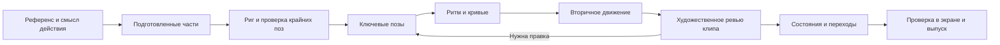

# Пайплайн анимации Rive для Chewy

> Проверено 6 ноября 2026. Исследование готовых процессов и текущих исходников.
> Рекомендации для обсуждения; реализация, финальный арт и новые механики сюда не входят.
> Текущая очередь — [TODO](TODO.md), производственный контракт — [CONTENT_PIPELINE](CONTENT_PIPELINE.md).

Для Chewy наиболее обоснован **общий редактируемый мастер Rive, поставленные ключевые позы и доводка движения в Editor, с CLI для сборки и повторяемых проверок**. Инструменты уже позволяют агенту делать риг и ключи, но качество нужно оценивать отдельно: сохраняется ли характер рисунка, чувствуется ли вес, естественны ли ритм и переходы.

Готовые процессы существуют в трёх полезных формах: официальный авторинг Editor ↔ CLI/MCP; разбираемые риги и учебные проекты; сторонний перенос движения из видео на риг. Последний наиболее близок к автоматическому получению новых действий, но его пригодность для нашего арта ещё требует сравнительной пробы.

## Что ограничивает текущие анимации

Проверены актуальные генераторы и RML, включая последние `camp-daily-states`. Ниже факты об устройстве движения и выводы о возможных ограничениях. Это не покадровая художественная оценка всех сохранённых видео.

| Объект | Что задают исходники | Что стоит изменить в подходе к анимации |
|---|---|---|
| Растения | Целый стебель с листьями и цветком вращается вокруг корня; `wave()` не имеет фазового сдвига | Поставить изгиб стебля, запаздывание головки и листьев. Развести фазы растений, сохраняя общий ветер |
| Лампа | Пламя меняет масштаб целиком, свечение — прозрачность | Отдельно поставить изменение контура огонька и спокойный отклик света |
| Костёр | Три контура деформируются аналитическими волнами; ступень дополнительно меняет масштаб | Разработать несколько фаз развития языков огня; при необходимости добавлять исчезающие/сменные формы |
| Смена стадий | Для четырёх объектов используются шестисекундные циклы и одинаковый blend 550 мс | Различать переход и движение внутри состояния. Сборка палатки требует собственной последовательности, усиление огня — другой |
| Герой в `hero-actions` | Синусы плеч/бёдер, сгибание коленей по формуле, фиксированные углы лодыжек; `Sit`/`Reach` — позы с дыханием | Поставить контакт стоп, перенос веса и промежуточные позы действия. Решать IK или ручными ключами под конкретный жест |

Источники: [генератор последних предметов](../content-pipeline/rive/camp-daily-states/generate.py) (`keys`, `wave`, `project`, `plants`, `lamp`), [деформация огня](../content-pipeline/rive/campfire-base/generate_scene.py) (`warp`), [действия героя](../content-pipeline/rive/hero-actions/make_draft.py), [ограничения рига героя](../content-pipeline/rive/hero-actions/README.md).

Эти приёмы годятся для технических проб. Гипотеза о текущем качестве: регулярность формул и простое смешивание поз дают ощущение механического движения. Добавление костей само по себе это не исправит — им тоже нужны поставленные позы и ритм. Линейная интерполяция между часто записанными отсчётами синуса также не означает, что всё движение имеет постоянную скорость; проблема шире выбора одного easing.

Техническую основу сохраняем: настоящие `.riv`, независимые состояния, статичный режим и runtime-превью уже есть. **Последние предметы собираются из сохранённых RML без регенерации**, с проверкой сохранности исходников: [build.py](../content-pipeline/rive/camp-daily-states/build.py). Это уточняет более ранние документы, где защита мастера была описана только для героя.

Текущий QA проверяет технические свойства. Например, [check_rig.py](../content-pipeline/rive/hero-actions/check_rig.py) измеряет изменение пикселей и стык цикла. Он не оценивает выразительность, вес и контакт стоп. Эти признаки требуют отдельного просмотра движения.

## Готовые маршруты и их пригодность

| Маршрут | Что уже доступно | Значение для Chewy |
|---|---|---|
| **Rive Editor → риг → timelines → State Machine** | Нативные bones, веса, mesh, constraints, графики интерполяции, сменные рисованные формы. [Официальный процесс](https://rive.app/use-cases/character-animation) | Базовый маршрут для качества. Все части и движения остаются доступны для правок |
| **Агент ↔ Rive CLI ↔ Editor** | Авторинг RML, preview, inspect, headless render, экспорт `.riv`/`.rev`, `push`/`pull`. [CLI](https://rive.app/docs/cli/overview) | Основная автоматизация для нашего репозитория: сборка, варианты, проверки и точечные изменения общего мастера |
| **Официальный Rive MCP / встроенный Agent** | MCP редактирует кости, веса, ключи, интерполяцию и состояния в открытом desktop Editor macOS/Windows. Встроенный Agent — отдельный способ работы внутри Editor. [MCP](https://rive.app/docs/editor/ai/mcp), [Agent](https://rive.app/docs/editor/ai-agent/ai-agent) | Удобны для совместной работы с визуальным редактором. MCP Editor не является headless-сервисом для Linux; CLI подходит для этого лучше |
| **Marketplace rig → адаптация арта → новые действия** | Есть скачиваемые и разбираемые риги с контроллерами и слоями поведения | Экономит проектирование структуры. Чужой риг не переносит автоматически характер и движения Chewy |
| **After Effects → Lottie → Rive** | Импорт поддерживаемого содержимого в редактируемые объекты. На дату проверки официальный Lottie import доступен на Enterprise; требуется оптимизация и возможная пересборка. [Lottie docs](https://rive.app/docs/editor/assets/lottie) | Полезно при готовой библиотеке AE. Для нового соло-пайплайна добавляет конвертацию и тарифное ограничение |
| **Adobe Animate → Rive** | Прямой импорт `.fla` (Animate CC+) или ZIP с XFL: символы, timelines, tweens, покадровые фазы и IK. Только первая сцена; часть эффектов и программной логики теряется. [Import](https://rive.app/docs/editor/assets/flash) | Реальный маршрут для уже готовой рисованной анимации; результат требует просмотра и чистки |
| **Polymation → Rive** | Вендор документирует сборку рига из изображения/PSD и перенос видео в ключи существующего рига | Отдельный кандидат на пробу; качество на Chewy не подтверждено. Подробности ниже |

Для импорта рисунка есть два разных входа: SVG превращается в объекты Rive; PSD сохраняет видимые слои как растровые части. Это позволяет выбирать вектор или сохранять фактуру рисунка. Ни один из этих импортов сам по себе не создаёт движение. [SVG](https://rive.app/docs/editor/assets/svg), [PSD](https://rive.app/docs/editor/assets/psd).

### Polymation и перенос движения из видео

Документированный маршрут: **готовый риг → изображение с уникальным цветом каждой части → анимация во внешней видеомодели → разбор кадров → `frames_to_rig` → ключи на исходном риге**. Вендор выдаёт сравнительный лист совпадения поз и проверку движения через `review_motion`.

Ограничения существенные: части в основном вращаются в суставах; укорочение конечностей, поворот в глубину и сложная деформация плохо представимы. Видеомодель должна сохранить плоские цвета. IK в новых клипах отключается, чтобы не перекрывать записанные ключи. Для Chewy это возможный источник чернового жеста, который затем доводится в Rive. [Motion from video](https://polymation.stunning.gg/docs/motion-from-video).

Это сторонний коммерческий продукт `rivemcp`, отдельный от официального Rive MCP. Изучены документация и репозиторий бинарных выпусков; инструмент на наших файлах не запускался. [Репозиторий производителя](https://github.com/paradoxsyn/rivemcp-releases), [подготовка рига из картинки](https://polymation.stunning.gg/docs/rig-from-picture).

## Что смотреть и разбирать в первую очередь

1. **Официальная змея на скейтборде.** Полный пример подготовки и проверки рига с mesh, Auto Trace, Auto Weights и ручной коррекцией. Полезен для понимания, почему автоматические веса — начальная настройка. [Видео](https://www.youtube.com/watch?v=0V3rK90K7HA), [публикация Rive с транскриптом](https://www.linkedin.com/posts/rive-app_rigging-a-snake-with-the-new-auto-trace-activity-7493370724280307712-VUX9). В исследовании доступен транскрипт; видео целиком не просмотрено.
2. **Interactive Character Rig от aln.omrv.** Разбираемый пример с костями, весами, пятью joysticks и независимым морганием. Страница предлагает Remix/Download и лицензию CC BY. Это учебная структура, не готовый персонаж Chewy. [Файл](https://rive.app/marketplace/28370-53642-interactive-character-rig-bones-joysticks-and-data-binding/).
3. **Duolingo Lily.** Производственный пример независимых анимаций головы и тела: команда сочетает по восемь вариантов, получает разнообразие поведения и отдельно доводит характер выражений. Заимствовать модульность после подготовки хороших базовых клипов. [Разбор](https://rive.app/blog/duolingo-s-ai-powered-video-call-brings-lily-to-life).
4. **Brilliant Koji.** Команда использует один подробный риг на разных платформах и интерактивный стенд для живой настройки параметров. Агент помогает формировать спецификацию передачи разработчику. Для нас особенно полезен цикл «изменил параметр → сразу увидел на персонаже». [Кейс команды](https://rive.app/blog/brilliant-builds-its-math-and-coding-tutor-character-with-rive).
5. **School of Motion Rive Academy.** Последовательное обучение от дизайна и анимации до интерактивности и внедрения. Подходит для освоения всего процесса; опубликованная программа не является автоматическим генератором персонажей. [Программа](https://schoolofmotion.com/blog/rive-academy).

Для отдельного просмотра файлов есть сторонний [Rive Animation Viewer](https://github.com/ivg-design/rive-animation-viewer) с переключением runtime/renderer, состояниями, Data Binding и экспортом превью. Его возможности проверены по README; устанавливать вместо нашего стенда пока нет необходимости.

## Предлагаемый процесс анимирования

Это рекомендация для Chewy на основе источников и локального аудита. Каждый этап имеет отдельный результат, который можно оценить до следующего.

| Этап | Что делаем | Что должно получиться |
|---|---|---|
| 1. Бриф движения | Выбрать референс, описать действие, характер, неподвижные опоры и условия завершения | Несколько опорных поз и понятное описание жеста, а не только «сделай живее» |
| 2. Подготовка арта | Разделить подвижные части, восстановить скрытые области, задать pivots и перекрытия | Неподвижная сборка совпадает с выбранным рисунком |
| 3. Риг | Жёсткие детали привязать к контроллерам; мягким дать деформацию; подготовить крайние позы | Руки/стебли сгибаются без щелей, лицо сохраняется, нужные контакты удерживаются |
| 4. Постановка поз | Сначала основная форма действия: подготовка → движение → выразительная поза → возврат | Действие понятно даже в виде последовательности неподвижных кадров |
| 5. Ритм и траектории | Настроить длительности, паузы, ускорения, дуги и остановки | В реальном времени чувствуется нужный вес и характер |
| 6. Вторичное движение | Добавить запаздывание головы, листьев, ткани; развести фазы; проверить возврат | Части связаны одним действием, но не движутся синхронно как одна картинка |
| 7. Ревью одного клипа | Смотреть в размере лагеря и крупно, повторять цикл, сравнить с референсом | Один принятый образец движения, который задаёт качество остальным |
| 8. Поведение | Соединить готовые клипы, развести слои и свойства, поставить необходимые переходные эпизоды | Смена состояния, повтор и прерывание работают без скачков и зависаний |
| 9. Выпуск | Проверить реальный runtime, сохранить мастер, контракт, превью и версии инструментов | Повторный выпуск воспроизводит принятый результат и сохраняет ручные правки |

Риг не обязан быть сложным. Rive поддерживает как простую привязку целой детали к кости, так и взвешенную деформацию векторов и растровых mesh. Выбираем механизм по требуемому сгибу; Auto Weights затем проверяем в крайних позах. [Bones](https://rive.app/docs/editor/manipulating-shapes/bones), [Meshes](https://rive.app/docs/editor/manipulating-shapes/meshes). Для удержания стопы или кисти есть [IK](https://rive.app/docs/editor/constraints/ik-constraint).

Ключи задают позы, кривые — характер изменения между ними. Graph Editor позволяет доводить это отдельно от геометрии. Автоматическое увеличение числа ключей не заменяет постановку ритма. [Interpolation](https://rive.app/docs/editor/animate-mode/interpolation-easing).

### Как применить к нашим объектам

**Растение** — самый ясный первый образец: неподвижный корень, изгиб стебля, запаздывающая головка и небольшой отклик листьев. Сравнение с текущим вращением целой группы сразу покажет, даёт ли процесс более естественное движение.

**Костёр и лампа** требуют работы с формой. Для огня стоит подготовить фазы вытягивания, сужения и исчезновения языков; общий свет должен оставаться спокойнее самого пламени. Рисованные сменные формы допустимы вместе с деформацией. Готовый скелет персонажа здесь мало полезен.

**Палатка** требует постановки изменения конструкции: каркас поднимается, ткань следует за ним, затем успокаивается. Короткая переходная анимация и спокойный цикл натянутой ткани выполняют разные задачи.

**Чуви** требует ключевых поз и контактов. Сначала один нужный жест с сохранением личности, затем библиотека на том же риге. Взгляд и моргание могут жить отдельно; одежда и шляпа следуют соответствующим частям. Ходьбу, сидение и повороты нельзя считать готовыми только по наличию одноимённых состояний.

## Состояния и переходы

State Machine управляет выбором и сочетанием подготовленных движений. Blend может плавно соединить свойства двух поз, но не придумывает перенос веса или последовательность сборки предмета. Если смысл действия теряется при интерполяции, нужен отдельный переходный клип.

Для героя разумно разделять основное действие и мимику, закрепив владельца каждого свойства. При конфликте Rive отдаёт приоритет слою ниже в списке. Это нужно учитывать, чтобы моргание или idle не перезаписывали жест. [Layers](https://rive.app/docs/editor/state-machine/layers).

Для каждой пары действий проверять вход/выход, повтор и прерывание. Rive предоставляет длительность перехода, Exit Time и управление выходом во время перехода; настройка зависит от действия. [Transitions](https://rive.app/docs/editor/state-machine/transitions). Игровое состояние и награды остаются в приложении и не ждут завершения анимации, согласно текущим правилам Chewy.

## Автоматизация и сохранность мастера

Агент может создавать и править геометрию, риг, ключи и состояния; CLI помогает проверять структуру и рендерить результат. Художественное задание должно содержать позы, ограничения и референсы, а итерации — конкретные замечания к увиденному движению. Официальная инструкция также предлагает работать по этапам и проверять результат через preview и render. [Работа с агентами](https://rive.app/docs/cli/agents).

В нашем процессе нужен один согласованный источник каждой версии: локальный проект RML и соответствующая редакторская ревизия. `.rev` служит редактируемым документом, `.riv` — экспортом для runtime. После работы в Editor правки возвращаются через `pull` или проверенный импорт, затем проходят сравнение. Нельзя запускать генератор поверх принятого мастера. Возможности этого круга документированы в [CLI](https://rive.app/docs/cli/overview); полный круг с реальной ручной правкой в Chewy ещё не подтверждён.

Минимальный пакет: исходный арт, мастер, контракт состояний, `.riv`, статичные виды, видео эталонного движения, версии CLI/runtime и результат проверки. Новые эффекты сверять с поддержкой целевой платформы. Успех web-превью не подтверждает iOS: [Feature Support](https://rive.app/docs/feature-support). Нативная проверка остаётся на согласованном этапе проекта.

## Как проверить выбранный процесс после исследования

Предложение следующей отдельной пробы: довести **одно растение на текущем рисунке** по описанным этапам и сравнить с существующим Rive. Затем повторить процесс на костре, чтобы проверить другой тип пластики. Герой требует собственной пробы жеста; успех предмета не доказывает качество персонажа. В текущем ресерче новые анимации не создавались.

Оценка должна покрывать пять вещей:

- **Рисунок:** узнаваемый силуэт и лицо, чистые соединения, стабильная опора.
- **Движение:** понятное действие, нужный вес, паузы и запаздывание частей; отсутствие непреднамеренного скольжения.
- **Поведение:** плавный цикл, корректные смены стадий, повтор и прерывание из разных фаз.
- **Экран:** читаемость в реальном размере, умеренная активность, сохранение смысла при reduced motion.
- **Редактирование:** конкретную правку ритма или позы можно внести без пересоздания рисунка; повторная сборка её сохраняет.

Для Polymation возможна дополнительная сравнительная проба на том же риге и том же жесте. Критерий полезности — более удачное движение и меньше ручной чистки до принятого результата. Сам факт экспорта `.riv`, число tools или автоматическая оценка качества этого не доказывают.
