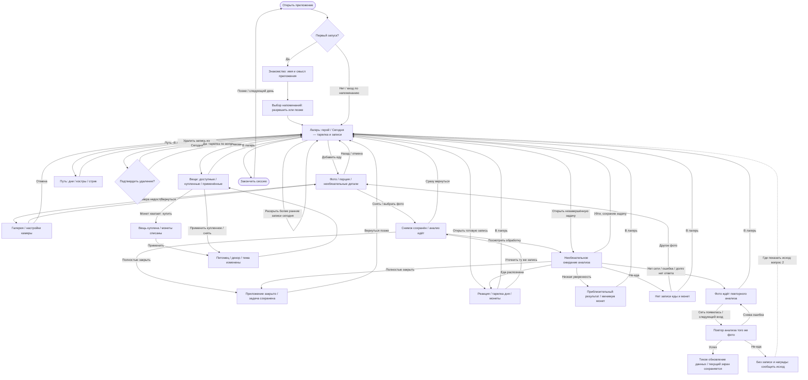

# chewy — сценарий и граф использования

> Актуальная проба добавления от 2026-10-27: **камера + лента снимков →
> «Разобрать» → лагерь**. Затвор добавляет фото в ленту над кнопками съёмки,
> камера остаётся открытой для следующего кадра. Несколько фото считаются одной записью;
> миниатюра открывает необязательный просмотр с пересъёмкой и удалением.
> Галерея добавляет выбранные фото в ту же ленту.
> Порция и заметка раскрываются по желанию. На результате «Уточнить результат»
> открывает поля и снимки; повтор заменяет ту же запись, сохраняя прежний результат
> до завершения. По уточнению владельца обязательный просмотр после затвора убран.
> Исторический сценарий ниже описывает прежнюю немедленную отправку после затвора.
> Гарантия возвращения к анализу начинается после подтверждения сохранения.
> Несохранённый набор снимков и отменённые правки в этой пробе не переживают перезагрузку.

> Результат от 2026-10-27: страница дневника с фото, названием и кратким выводом
> сверху, четыре запаса сеткой 2×2 ниже. Несколько фото и подробности раскрываются
> по желанию. Внизу всегда доступны «Уточнить» и «В лагерь»; уточнение использует
> прежнюю форму и повторно анализирует ту же запись.

> После ревью текст скрыт до запроса: нажатие на короткую оценку раскрывает её
> причину и совет, на запас — его источник и пояснение шкалы. Открыта одна
> подробность; повторное нажатие или крестик сворачивает её.

> Черновик для обсуждения с владельцем от 2026-10-14; рабочий порядок — в [MVP_PLAN.md](MVP_PLAN.md).
> Сценарий ещё **не согласован**. По уточнению от 2026-10-25 сейчас экран за экраном набрасываем примерный вид на канвасе; затем генерируем контент и собираем с ним прототип в Storybook.
> Действие пользователя: **«Добавить еду»**. Русские подписи ниже — рабочий язык
> обсуждения; финальный язык приложения пока не выбран.

> Порядок работы от 2026-10-17: сейчас ревью основного цикла с прямым входом в лагерь.
> Онбординг, имя и предложение напоминаний — после рабочего кора в Storybook.
> Сценарий первого знакомства ниже сохранён как отложенный черновик; граф показывает
> целевое приложение, а ранний прототип начинается с узла «Лагерь».

> Проба от 2026-10-24: в `Core/Skeleton` журнал дня объединён с лагерем. Герой сверху,
> ниже «Сегодня»: тарелка, последние записи и раскрытие более ранних записей сегодня.
> Сценарий и граф ниже отражают эту компоновку для ревью; окончательно она не согласована.
> Добавление еды и результат остаются отдельными экранами; прежний прототип сохранён.

> Проба от 2026-10-25: `Core/Canvas` → «Сегодня · походный дневник». Вместо текстовой
> области — мини-страница с тарелкой и последними добавлениями. Нажатие раскрывает её
> в сегодняшние записи, закрытие возвращает на место. Это отдельная демонстрация метафоры
> и перехода; выбор оформления и связь с полным циклом добавления еды ещё впереди.

> Следующее уточнение от 2026-10-25: главный экран с дневником оставляем как рабочую
> версию и переходим к канвасу добавления еды. По дальнейшим уточнениям владельца камера
> занимает весь экран; можно добавить детали заранее, быстро снять и полностью закрыть
> приложение. Результат доступен при возвращении и допускает уточнения того же снимка.
> Камера, галерея и анализ пока подставляют пример; демонстрационная задача переживает
> перезагрузку браузера. Это моделирует сценарий, а не гарантирует фоновый запрос в iOS.

## Зачем человек открывает приложение

Человек добавляет фото своего приёма пищи, видит реакцию знакомого героя и получает
монеты. За день складывается понятная картинка питания без подсчёта калорий.
Заработанные монеты позволяют выбрать питомца, украсить лагерь или сменить оформление
анализа. Причина вернуться — увидеть героя, добавить следующую еду и постепенно
обустроить своё место. Смотреть лагерь и покупки можно без обязательного нового фото.

**Цикл:** лагерь → «Добавить еду» → реакция и результат → обновлённый лагерь →
«Сегодня» в лагере / путь / покупка → выход → возвращение к следующему приёму пищи.

## На что уже договорились опираться

Правила — из [DESIGN.md](DESIGN.md), [DECISIONS.md](DECISIONS.md) и текущего скоупа
[TODO.md](TODO.md). Детали [архивной SPEC v5](archive/spec/SPEC_v5.md) и существующий Storybook — материал
для проверки; расхождения ниже не превращаются автоматически в решения.

- Нет калорий, БЖУ, веса и процентов питания. Числа допустимы для монет, цен и стрика;
  время записи помогает узнать приём пищи. Тарелка дня показывается секторами.
- Герой — друг: не умирает, не стыдит, тело не меняет. Любая записанная еда учитывается;
  состав еды и размер порции не вызывают вялость или реплики о переедании.
- За запись еды есть минимум монет; бонус зависит от вклада в незаполненные сектора
  дня. Полная тарелка и лимит бонусов не запрещают добавлять еду дальше.
- Низкая уверенность анализа: запись, приблизительная тарелка, минимум монет.
  Не-еда: без записи еды и монет; новое правило награды за такую попытку не вводим.
- Новый день начинает новую тарелку и журнал. Монеты, покупки и рекорд сохраняются.
  Один полностью пропущенный день приостанавливает стрик; два подряд прерывают текущую
  цепочку. Сегодня без записи ещё не считается пропущенным днём.
- Ошибка сети не должна уничтожать фото или стрик. Награда ждёт результата анализа.
- В Сборке 1: декор, питомцы, темы анализа; добровольные напоминания. Одежда, квесты,
  вылазки, биомы, развитие построек, платные функции и история журнала по дням отложены.
- Пороги, события и методика [VALIDATION.md](VALIDATION.md) остаются прежними.
  Переименование пользовательского действия не переименовывает событие `feed`.

## Три основных сценария

### Первый запуск — черновик для ревью после готового кора

1. Человек видит героя в лагере, даёт ему имя или оставляет предложенное. Аккаунт,
   параметры тела и цели по весу не нужны. Конкретное имя по умолчанию ещё выбираем.
2. Короткое знакомство объясняет цикл: фото еды → реакция → монеты → вещи для лагеря.
   Любую еду можно записать; приложение не выдаёт оценки человеку.
3. Выбор напоминаний добровольный. Только согласие вызывает системный запрос;
   отказ или «позже» ведёт дальше с теми же возможностями приложения.
4. Открывается пустой лагерь: герой, секция «Сегодня» с пустой тарелкой и без записей, начало пути.
   Нет выдуманных прошлых дней, покупок или стрика. Стартовый баланс — открытый тюнинг,
   демонстрационные монеты Storybook не считаются решением.
5. «Добавить еду» открывает фото и выбор порции. Камера запрашивается здесь, когда
   она нужна. При отказе остаются галерея и выход в лагерь.
6. Человек снимает или выбирает фото; по желанию заранее добавляет детали. Снимок
   сохраняется, можно сразу вернуться в лагерь или полностью закрыть приложение.
   Ожидание открывается по желанию. Позже результат показывает название еды,
   реакцию героя, изменение **тарелки дня** и заработанные монеты. Название, порцию
   и детали можно уточнить: повтор обновляет ту же запись. Ошибки описаны ниже.
7. «В лагерь» возвращает к уже обновлённым записи, тарелке и балансу. Реакция ещё
   ощущается в лагере; нажатие этой кнопки не является условием выдачи награды.
8. Можно открыть рюкзак, выбрать цель для будущей покупки или закончить сессию.
   Первая покупка не обязательна и не гарантируется сразу после первого фото.

**Человек понял:** как добавить еду, где увидеть результат и зачем нужны монеты.

### Обычная сессия — быстро добавить еду или посмотреть свой мир

1. Открытие ведёт в лагерь с сохранёнными вещами и сегодняшними записями.
2. Если есть новая еда: «Добавить еду» → фото и порция, необязательные детали →
   снимок сохранён → лагерь или закрытие приложения. Смотреть ожидание необязательно;
   готовый результат можно открыть позже и уточнить. Повторное нажатие и уточнение
   одного снимка не создают второй приём и вторую награду.
3. Тарелка показывает вклад в общий день; повторение уже заполненного сектора не
   увеличивает его бесконечно. Запись и минимальная награда остаются.
4. Секция «Сегодня» под героем отвечает «что я уже добавил сегодня»: тарелка и последние
   записи видны сразу, более ранние записи дня раскрываются на месте. Путь отвечает
   «как я возвращался по дням». Просмотр и раскрытие записей не меняют прогресс.
5. Если монет хватает: рюкзак → покупка → применение → лагерь с новой вещью.
   Если не хватает, можно посмотреть другие вещи и выйти; требования добавить ещё
   еды ради покупки нет. Косметика меняет оформление, не правила наград.
6. После подтверждения сохранения снимка человек может полностью закрыть приложение;
   задача и уже полученный результат сохраняются. При возвращении виден результат
   либо состояние ещё незавершённой обработки.

**Пример дня:** утром овсянка с ягодами дополняет тарелку, днём другой приём добавляет
вклад в незаполненные сектора. Вечером пицца тоже появляется в журнале и даёт минимум
монет; герой реагирует доброжелательно. Точная награда зависит
от уже заполненной тарелки и существующего тюнинга, а не от «хорошего/плохого» дня.

### Возвращение завтра — продолжить без повторного обучения

1. Вход вручную или по добровольному напоминанию ведёт в лагерь. Онбординг не повторяется.
2. Герой, вещи, баланс и рекорд на месте. Тарелка и записи в секции «Сегодня» пусты;
   вчерашний результат не должен мигать как сегодняшний. Отдельного «итога вчера» нет.
3. В пути остаются настоящие прошлые дни. Первый новый приём продолжает цепочку;
   несколько записей одного дня не добавляют несколько дней стрика.
4. После одного пропущенного дня виден тлеющий костёр и прежний счётчик; новый приём
   продолжает цепочку. После двух и более начинается новая, рекорд и покупки остаются.
5. Вчерашнее фото, ожидающее анализа, относится ко вчерашнему дню даже при ответе
   сегодня. Его награда может пополнить баланс, но не заполняет сегодняшнюю тарелку.
   Где видеть и отменять такое ожидание — вопрос 2.
6. Ночью герой отдыхает и напоминания не приходят. Добавить еду по своей инициативе
   всё равно можно. Ночные часы и тайминги реакции уточняются отдельно от графа.

## Граф использования

Сплошные стрелки — основной маршрут черновика с пробой секции «Сегодня» в лагере.
Пунктир — предлагаемое поведение, которое ещё нужно согласовать (вопрос 2).
«Отмена» ниже относится к действию **до отправки** фото; после отправки это отдельный случай.

## Выходы, пустые состояния и незавершённые действия

- **Онбординг:** SPEC предлагает после закрытия посередине начать знакомство заново;
  после завершения — всегда лагерь. Возврат к предыдущей карточке предлагаем разрешить
  без сброса имени. Это выбор навигации для ревью, а не готовая функция прототипа.
- **Пустой день:** в лагере секция «Сегодня» с пустой тарелкой и «Сегодня пока нет записей»;
  рядом доступно «Добавить еду». В пути нет фиктивной истории, в рюкзаке доступны просмотр каталога
  и возврат даже без денег. Не требуется обязательная покупка или заполненная тарелка.
- **Фото до отправки:** назад не создаёт запись, награду или день стрика. Отмена галереи
  возвращает на экран фото. Отказ в камере оставляет галерею, настройки и выход.
  SPEC предлагает отправку одним действием, без отдельного обязательного экрана проверки.
- **После отправки:** повторные нажатия не создают дубли. Подтверждение сохранения
  означает, что можно уйти с экрана или полностью закрыть приложение: снимок, задача
  и результат не теряются. Выход не равен удалению. Отмену и удаление ожидающего фото
  ещё нужно решить — вопрос 2.
- **Результат:** «В лагерь» не отправляет фото повторно. Отдельное «Уточнить анализ»
  передаёт исправленные название, порцию и детали для той же записи; пока идёт повтор,
  дневник сохраняет предыдущий результат. Из дневника можно снова открыть запись.
  Не-еда дополнительно предлагает другое фото. При низкой уверенности повтор не создаём
  автоматически: сначала показываем честный результат существующей записи.
- **Записи в «Сегодня»:** последние видны под тарелкой, более ранние записи дня
  раскрываются без перехода. Удаление требует подтверждения, «Оставить» закрывает
  его без изменений; последствия удаления остаются вопросом 1. Удаление ещё не реализовано
  в скелете. Путь открывается из лагеря и возвращает туда же. Историю прошлых дней не добавляем.
- **Рюкзак:** купить и применить — разные действия по SPEC; автоприменение покупки
  ещё не утверждено. При замене питомца/темы прежнее остаётся купленным. Снятие темы
  возвращает базовую таверну. Продажа, возврат монет и платные усиления не входят.
- **Ожидание через полночь:** дата записи — день отправки, не день ответа и не дата
  из фотографии. Сообщение об исходе должно быть доступно даже после смены дня — вопрос 2.

## Расхождения и вопросы до согласования сценариев

Это точки выбора, а не разрешение самостоятельно менять правила.

| № | Что расходится | Что нужно решить / предложение для обсуждения |
|---|---|---|
| **1. Удаление и тарелка** | SPEC §5.4 пересчитывает тарелку без удалённой записи; `ChewyApp.jsx` оставляет её заполненной. И там и там монеты и учёт дня сохраняются | **Предложение:** пересчитывать тарелку, чтобы она соответствовала журналу; не отзывать монеты, не возвращать использованный бонусный слот, не обнулять день. Нужен выбор владельца |
| **2. Ожидание, выход и повтор** | SPEC не гарантирует сохранение фото после полного закрытия до ошибки; незавершённые фото могут относиться к прошлому дню | **Владелец подтвердил 2026-10-25:** быстро снять и полностью закрыть приложение, вернуться к результату позже; добровольный просмотр ожидания, уточнения до запроса и на результате. Снимок/задача сохраняются, уточнение относится к той же записи. **Остаётся решить:** отмену/удаление ожидающего фото и последствия для дня, объяснение поздней не-еды. Камера и очередь в текущем канвасе — моки |
| **3. Сколько декора одновременно** | Прототип и SPEC используют один активный декор; SPEC §15 оставляет вопрос открытым, а каталог описывает разные места лагеря | Выбрать один заменяемый предмет или несколько одновременно. Это влияет на смысл покупок и следующий этап устройства сцены; число мест сейчас не придумываем |

**Не-еда — расхождение реализации с правилом, а не новый выбор награды.**
DESIGN/DECISIONS уже задают «без лога и монет». SPEC §5.7 при этом отмечает день
до анализа и оставляет его даже после не-еды. При переносе нельзя принять этот
побочный эффект за утверждённый способ получить прогресс. Защиту ожидающего фото
от ошибки сети нужно отличать от подтверждённой записи еды; поздний отказ анализа
и его объяснение входят в вопрос 2. Само правило не-еды повторно не согласовываем.

**Не блокируют основной граф, но требуют решения до соответствующей реализации:**
стартовые монеты и момент первой доступной покупки; пороги бонусов/уверенности,
пересмотр коэффициента цельности; тайминги и ночные часы; язык и имя героя.
SPEC и прототип используют разные формы ответа анализа и тюнинг. Этот документ
не утверждает новую схему, конкретные числа или новые состояния героя.

Прочие найденные пробелы прототипа для этапа 3: мгновенный анализ, демонстрационная
история новичка, потеря выбора напоминаний, отсутствие прямого повтора после не-еды,
бонус при низкой уверенности и неполное сохранение реакции при возврате в лагерь.
Биомы из демонстрации пути остаются идеей, не обязательным прогрессом Сборки 1.

## Как проверить и закончить этап

Сейчас пройти граф на словах: лагерь → первая еда → результат → лагерь; повторный приём → «Сегодня»;
покупка → применение → изменённый лагерь; возврат завтра и после пропуска.
В скелете проверить пробу «Сегодня»: герой остаётся сверху, записи читаются рядом
с тарелкой, раскрытие более ранних записей дня не требует отдельного экрана.
Отдельно пройти отказ в камере, отмену фото, не-еду, низкую уверенность, отсутствие
сети, повтор, закрытие во время ожидания, поздний ответ и удаление записи.

Для каждого прохода понятно: куда можно выйти, что уже сохранено, что ещё ожидается
и почему человек вернётся. Вопросы 1–3 разобраны с владельцем и внесены в решения.
Сейчас разбираем примерный вид экранов на канвасе, уточняя сценарии по мере необходимости.
Полный проход проверяем в Storybook с контентом после его генерации; спорные правила
согласуем до реализации соответствующей логики. Ревью первого знакомства возвращается после рабочего кора;
оно должно завершиться до согласования полного прототипа и перехода к iOS.
Этот черновик сам по себе согласованием не является.

### Проба связи результата и лагеря · 2026-10-27

На результате четыре предмета сопровождают понятные названия питания.
Нажатие раскрывает связь предмета с лагерем и источник в еде. Первый возврат
из готового результата показывает короткий перелёт одного предмета к зоне
лагеря. Уже просмотренная запись и неизвестный состав не запускают отклик.
Пока это только визуальный переход; новые предметы и рост не начисляются.

### Сегодня · компактная проба · 2026-10-27

Лист раскрывается из лагеря. Сверху четыре запаса и короткая оценка дня,
ниже лента фотографий еды. Запас или оценка раскрывает пояснение; фотография
открывает результат блюда. Повторное нажатие или крестик скрывает пояснение.
В пустом дне «Добавить еду» закрывает дневник и открывает камеру. Закрытие
листа возвращает в лагерь, фокус — на «Сегодня».
