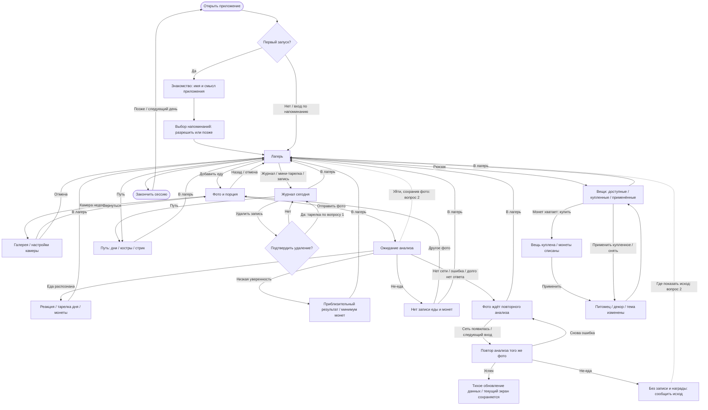

# chewy — сценарий и граф использования

> Этап 1 из [MVP_PLAN.md](MVP_PLAN.md). Черновик для обсуждения с владельцем, 2026-10-14.
> Сценарий описан; этап ещё **не согласован**. Код, Storybook и ассеты не меняем.
> Действие пользователя: **«Добавить еду»**. Русские подписи ниже — рабочий язык
> обсуждения; финальный язык приложения пока не выбран.

## Зачем человек открывает приложение

Человек добавляет фото своего приёма пищи, видит реакцию знакомого героя и получает
монеты. За день складывается понятная картинка питания без подсчёта калорий.
Заработанные монеты позволяют выбрать питомца, украсить лагерь или сменить оформление
анализа. Причина вернуться — увидеть героя, добавить следующую еду и постепенно
обустроить своё место. Смотреть лагерь и покупки можно без обязательного нового фото.

**Цикл:** лагерь → «Добавить еду» → реакция и результат → обновлённый лагерь →
журнал / путь / покупка → выход → возвращение к следующему приёму пищи.

## На что уже договорились опираться

Правила — из [DESIGN.md](DESIGN.md), [DECISIONS.md](DECISIONS.md) и текущего скоупа
[TODO.md](TODO.md). Детали [SPEC v5](spec/SPEC_v5.md) и существующий Storybook — материал
для проверки; расхождения ниже не превращаются автоматически в решения.

- Нет калорий, БЖУ, веса и процентов питания. Числа допустимы для монет, цен и стрика;
  время записи помогает узнать приём пищи. Тарелка дня показывается секторами.
- Герой — друг: не умирает, не стыдит, тело не меняет. Любая записанная еда учитывается;
  реакция на тяжёлую еду не отнимает заработанное и не прерывает стрик.
- За запись еды есть минимум монет; бонус зависит от вклада в незаполненные сектора
  дня. Полная тарелка и лимит бонусов не запрещают добавлять еду дальше.
- Низкая уверенность анализа: запись, приблизительная тарелка, минимум монет.
  Не-еда: без записи еды и монет; новое правило награды за такую попытку не вводим.
- Новый день начинает новую тарелку и журнал. Монеты, покупки и рекорд сохраняются.
  Один полностью пропущенный день приостанавливает стрик; два подряд прерывают текущую
  цепочку. Сегодня без записи ещё не считается пропущенным днём.
- Ошибка сети не должна уничтожать фото или стрик. Награда ждёт результата анализа.
- В Сборке 1: декор, питомцы, темы анализа; добровольные напоминания. Одежда, квесты,
  вылазки, биомы, развитие построек, платные функции и история журнала по дням отложены.
- Пороги, события и методика [VALIDATION.md](VALIDATION.md) остаются прежними.
  Переименование пользовательского действия не переименовывает событие `feed`.

## Три основных сценария

### Первый запуск — познакомиться и получить первый понятный результат

1. Человек видит героя в лагере, даёт ему имя или оставляет предложенное. Аккаунт,
   параметры тела и цели по весу не нужны. Конкретное имя по умолчанию ещё выбираем.
2. Короткое знакомство объясняет цикл: фото еды → реакция → монеты → вещи для лагеря.
   Любую еду можно записать; приложение не выдаёт оценки человеку.
3. Выбор напоминаний добровольный. Только согласие вызывает системный запрос;
   отказ или «позже» ведёт дальше с теми же возможностями приложения.
4. Открывается пустой лагерь: герой, пустая тарелка, журнал без записей, начало пути.
   Нет выдуманных прошлых дней, покупок или стрика. Стартовый баланс — открытый тюнинг,
   демонстрационные монеты Storybook не считаются решением.
5. «Добавить еду» открывает фото и выбор порции. Камера запрашивается здесь, когда
   она нужна. При отказе остаются галерея и выход в лагерь.
6. Человек отправляет фото, видит ожидание, затем реакцию героя, название еды,
   изменение **тарелки дня** и заработанные монеты. Ошибки описаны ниже.
7. «В лагерь» возвращает к уже обновлённым записи, тарелке и балансу. Реакция ещё
   ощущается в лагере; нажатие этой кнопки не является условием выдачи награды.
8. Можно открыть рюкзак, выбрать цель для будущей покупки или закончить сессию.
   Первая покупка не обязательна и не гарантируется сразу после первого фото.

**Человек понял:** как добавить еду, где увидеть результат и зачем нужны монеты.

### Обычная сессия — быстро добавить еду или посмотреть свой мир

1. Открытие ведёт в лагерь с сохранёнными вещами и сегодняшними записями.
2. Если есть новая еда: «Добавить еду» → фото и порция → ожидание → результат → лагерь.
   Повторное нажатие во время анализа не создаёт второй приём и вторую награду.
3. Тарелка показывает вклад в общий день; повторение уже заполненного сектора не
   увеличивает его бесконечно. Запись и минимальная награда остаются.
4. Журнал отвечает «что я уже добавил сегодня», путь — «как я возвращался по дням».
   Ни просмотр этих экранов, ни возврат в лагерь сами по себе не меняют прогресс.
5. Если монет хватает: рюкзак → покупка → применение → лагерь с новой вещью.
   Если не хватает, можно посмотреть другие вещи и выйти; требования добавить ещё
   еды ради покупки нет. Косметика меняет оформление, не правила наград.
6. Человек закрывает приложение в любой момент; уже полученный результат сохраняется.

**Пример дня:** утром овсянка с ягодами дополняет тарелку, днём другой приём добавляет
вклад в незаполненные сектора. Вечером пицца тоже появляется в журнале и даёт минимум
монет; возможная сонная реакция героя не сопровождается упрёком. Точная награда зависит
от уже заполненной тарелки и существующего тюнинга, а не от «хорошего/плохого» дня.

### Возвращение завтра — продолжить без повторного обучения

1. Вход вручную или по добровольному напоминанию ведёт в лагерь. Онбординг не повторяется.
2. Герой, вещи, баланс и рекорд на месте. Сегодняшняя тарелка и журнал пусты;
   вчерашний результат не должен мигать как сегодняшний. Отдельного «итога вчера» нет.
3. В пути остаются настоящие прошлые дни. Первый новый приём продолжает цепочку;
   несколько записей одного дня не добавляют несколько дней стрика.
4. После одного пропущенного дня виден тлеющий костёр и прежний счётчик; новый приём
   продолжает цепочку. После двух и более начинается новая, рекорд и покупки остаются.
5. Вчерашнее фото, ожидающее анализа, относится ко вчерашнему дню даже при ответе
   сегодня. Его награда может пополнить баланс, но не заполняет сегодняшнюю тарелку.
   Где видеть и отменять такое ожидание — вопрос 2.
6. Ночью герой отдыхает и напоминания не приходят. Добавить еду по своей инициативе
   всё равно можно. Ночные часы и тайминги реакции уточняются отдельно от графа.

## Граф использования

Сплошные стрелки — основной маршрут по действующим правилам и спецификации.
Пунктир — предлагаемое поведение, которое ещё нужно согласовать (вопрос 2).
«Отмена» ниже относится к действию **до отправки** фото; после отправки это отдельный случай.

## Что меняется после каждого действия

| Место и действие | Что человек видит / что сохраняется | Польза и выход |
|---|---|---|
| Знакомство: имя, далее, выбор напоминаний | Герой получает имя; выбор сохраняется после завершения | Понимание цикла → лагерь. Отказ в разрешении не блокирует вход |
| Лагерь: открыть журнал, путь или рюкзак | Меняется только экран; данные не начисляются заново | Проверить день, прогресс или покупки; каждый экран ведёт в лагерь |
| Фото: камера / галерея / выбор порции | Подготовлен кадр и одна из трёх словесных порций, без граммов | Быстро добавить текущую еду; отмена системного выбора возвращает на фото |
| Успешный анализ еды | Одна запись, вклад в тарелку, монеты, реакция; день учитывается в пути | Видимый результат → лагерь. Бонус ограничен по действующим правилам |
| Низкая уверенность | Запись и приблизительные сектора; только минимум монет, честная фраза неуверенности | Можно продолжить или удалить ошибочную запись в журнале; ручного изменения секторов нет |
| Не-еда | Игровая реакция без записи еды, тарелки и монет | Другое фото → экран фото; отказ от повтора → лагерь. Правило «не-еда без лога» сохраняется |
| Нет сети / ошибка анализа | Фото сохранено как ожидающее; монет и вклада ещё нет; сеть не срывает стрик | Не нужно держать приложение открытым; повтор автоматически при возможности |
| Повтор ожидания завершён | Ожидающая запись заменяется итогом; монеты выдаются однократно за исходное фото | Обновление в месте текущего просмотра, без принудительного открытия результата |
| Журнал: удалить / оставить | Подтверждение отменяется без изменений; удаление убирает запись | Исправить ошибку. Монеты и рекорд не отнимаются; тарелка — вопрос 1 |
| Рюкзак: купить | Баланс уменьшается на цену один раз; предмет становится своим | Затем применить или вернуться позже. Недостаток монет ничего не списывает |
| Рюкзак: применить / снять | Вещь не покупается повторно; меняется питомец, декор или тема | Лагерь подтверждает изменение; тема видна при следующем «Добавить еду» |
| Закрыть приложение и открыть снова | Завершённые действия сохраняются; новый день обновляет только дневное | Продолжить без повторной оплаты, анализа или выдачи наград |

## Выходы, пустые состояния и незавершённые действия

- **Онбординг:** SPEC предлагает после закрытия посередине начать знакомство заново;
  после завершения — всегда лагерь. Возврат к предыдущей карточке предлагаем разрешить
  без сброса имени. Это выбор навигации для ревью, а не готовая функция прототипа.
- **Пустой день:** пустая тарелка и «Сегодня пока нет записей»; основной выход — лагерь
  и «Добавить еду». В пути нет фиктивной истории, в рюкзаке доступны просмотр каталога
  и возврат даже без денег. Не требуется обязательная покупка или заполненная тарелка.
- **Фото до отправки:** назад не создаёт запись, награду или день стрика. Отмена галереи
  возвращает на экран фото. Отказ в камере оставляет галерею, настройки и выход.
  SPEC предлагает отправку одним действием, без отдельного обязательного экрана проверки.
- **После отправки:** повторные нажатия не создают дубли. Уход в фон и возврат не должны
  терять результат. Выход из ожидания, принудительное закрытие приложения и удаление
  ожидающего фото требуют единого решения — вопрос 2. Выход с экрана не равен удалению.
- **Результат:** кнопка ведёт в лагерь; заново отправить уже обработанное фото она не может.
  Не-еда дополнительно предлагает другое фото. При низкой уверенности повтор не создаём
  автоматически: сначала показываем честный результат существующей записи.
- **Журнал:** удаление требует подтверждения, «Оставить» закрывает его без изменений.
  Из журнала можно открыть путь; явная кнопка «В лагерь» оттуда ведёт в лагерь, не обещает
  возврат в журнал. Журнал прошлых дней в этот граф не добавляем.
- **Рюкзак:** купить и применить — разные действия по SPEC; автоприменение покупки
  ещё не утверждено. При замене питомца/темы прежнее остаётся купленным. Снятие темы
  возвращает базовую таверну. Продажа, возврат монет и платные усиления не входят.
- **Ожидание через полночь:** дата записи — день отправки, не день ответа и не дата
  из фотографии. Сообщение об исходе должно быть доступно даже после смены дня — вопрос 2.

## Расхождения и вопросы до согласования этапа 1

Это точки выбора, а не разрешение самостоятельно менять правила.

| № | Что расходится | Что нужно решить / предложение для обсуждения |
|---|---|---|
| **1. Удаление и тарелка** | SPEC §5.4 пересчитывает тарелку без удалённой записи; `ChewyApp.jsx` оставляет её заполненной. И там и там монеты и учёт дня сохраняются | **Предложение:** пересчитывать тарелку, чтобы она соответствовала журналу; не отзывать монеты, не возвращать использованный бонусный слот, не обнулять день. Нужен выбор владельца |
| **2. Ожидание, выход и повтор** | SPEC описывает очередь после ошибки, но не гарантирует переживание принудительного закрытия до ошибки; журнал только за сегодня скрывает вчерашнюю очередь. Поздняя не-еда удаляется без понятного пользователю исхода | **Предложение:** после отправки фото переживает закрытие; можно уйти в лагерь. Нерешённые фото доступны из лагеря независимо от даты; доступны повтор и удаление с подтверждением. Автоповтор не открывает чужой экран; позднюю не-еду объясняем. Подтвердить маршрут и последствия отмены для дня |
| **3. Сколько декора одновременно** | Прототип и SPEC используют один активный декор; SPEC §15 оставляет вопрос открытым, а каталог описывает разные места лагеря | Выбрать один заменяемый предмет или несколько одновременно. Это влияет на смысл покупок и следующий этап устройства сцены; число мест сейчас не придумываем |

**Не-еда — расхождение реализации с правилом, а не новый выбор награды.**
DESIGN/DECISIONS уже задают «без лога и монет». SPEC §5.7 при этом отмечает день
до анализа и оставляет его даже после не-еды. При переносе нельзя принять этот
побочный эффект за утверждённый способ получить прогресс. Защиту ожидающего фото
от ошибки сети нужно отличать от подтверждённой записи еды; поздний отказ анализа
и его объяснение входят в вопрос 2. Само правило не-еды повторно не согласовываем.

**Не блокируют основной граф, но требуют решения до соответствующей реализации:**
стартовые монеты и момент первой доступной покупки; пороги бонусов/уверенности,
обработка цельности и критерий тяжёлой еды; тайминги и ночные часы; язык и имя героя.
SPEC и прототип используют разные формы ответа анализа и тюнинг. Этот документ
не утверждает новую схему, конкретные числа или новые состояния героя.

Прочие найденные пробелы прототипа для этапа 3: мгновенный анализ, демонстрационная
история новичка, потеря выбора напоминаний, отсутствие прямого повтора после не-еды,
бонус при низкой уверенности и неполное сохранение реакции при возврате в лагерь.
Биомы из демонстрации пути остаются идеей, не обязательным прогрессом Сборки 1.

## Как проверить и закончить этап

Пройти граф на словах: первый запуск → первая еда → лагерь; повторный приём → журнал;
покупка → применение → изменённый лагерь; возврат завтра и после пропуска.
Отдельно пройти отказ в камере, отмену фото, не-еду, низкую уверенность, отсутствие
сети, повтор, закрытие во время ожидания, поздний ответ и удаление записи.

Для каждого прохода понятно: куда можно выйти, что уже сохранено, что ещё ожидается
и почему человек вернётся. Вопросы 1–3 разобраны с владельцем и внесены в решения.
**Только после этого этап 1 завершён:** можно разбирать устройство экранов и требования
к ассетам на этапе 2. Этот черновик сам по себе согласованием не является.
