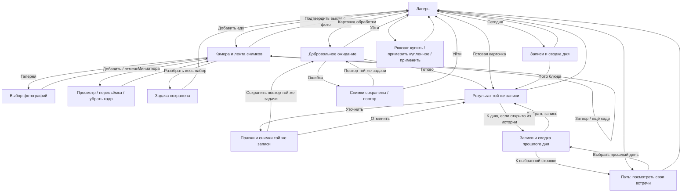

# chewy — основной сценарий прототипа

> Актуальная схема на 29 октября 2026; история прежних потоков — в архиве.
> Правила и открытые решения — [DESIGN](DESIGN.md), наличие состояний —
> [SCREEN_STUDIES](SCREEN_STUDIES.md), порядок завершения — [TODO](TODO.md).
> Поведение этапа 2 согласовано; ниже отдельно отмечены возможности текущего демо.
> Общее сохранение, награды, дневной вклад и условные состояния героя реализованы
> в 3.1–3.4 вместе с покупкой и примеркой; в 3.5 подключена история через путь.
> В 3.6 пройден единый успешный цикл с перезагрузками, новым днём, историей и сбросом.
> Три дефекта перепроверки исправлены: сохранение между вкладками, дата уведомления
> и позиция карты при смене размера. После полной регрессии этап 3 закрыт; очередь — TODO.
> В 4.1 связаны ошибки связи/сервиса/отсутствия ответа, сохранение и повтор той же
> задачи, включая доступ к прежнему результату уточнения. В 4.2 подключены не-еда
> и неопределённость, исправление той же задачи и сохранение известного вклада.
> В 4.3 связаны разрешения и отмены/удаление; в 4.4 проверены поздние ответы,
> смена дня/зоны и несколько результатов. F4–F11 пройдены, этап 4 закрыт.
> Визуальная доводка остаётся этапом 5, приёмка core — этапом 6.

## Проба Rive в основном демо · 6 ноября

В «Прототип / Приложение» нажать «+ Еда», снять тестовое фото или выбрать снимок
из галереи, затем «Сохранить и разобрать». Вернуться в лагерь и дождаться ответа
либо нажать «Инструменты пробы → Завершить анализ». Повторить три раза.
По умолчанию выбран «Случайный тестовый состав»: числа остаются внутри мока,
результаты сохраняются в дневнике, палатка, костёр, лампа и базовые растения
переходят между тремя образцами. «Следующий день» в инструментах начинает
пустой дневной вклад; история и накопления сохраняются. Для прежних заданных
примеров выбрать «Ответ анализа → Готовый результат».

## Самостоятельное ревью за 10 минут

Вход: `/review.html` на сервере из [инструкции запуска](../prototype/README.md#запуск)
или Storybook → «Ревью / Один день вместе». Отдельная сохраняемая сессия использует
основные экраны и правила. Камера и анализ остаются моками; ответ и день переключаются
в панели рядом с телефоном. Если проба уже начата, можно продолжить или нажать
«Начать проход заново»; основной прогресс и ручная раскладка не меняются.
На телефоне инструкция свёрнута под «Как пройти этот шаг»; ссылки «К прототипу»
и «К управлению разбором» переключают между сценой и кнопками мока.

| Время | Действие | Что оценить |
|---|---|---|
| 0–2 мин | «+ Еда» → «Галерея» → «Завтрак» → добавить фото → сохранить. В панели «Получить демоответ», затем в лагере «Сегодня» → готовый разбор → назад | Понятна ли связь между блюдом, первым свёртком припасов и садом? |
| 2–4 мин | Добавить ещё один «Завтрак» тем же способом, получить и посмотреть разбор | Новая запись и монеты есть, наполнение в демо пока то же. Целевой вид — ступени активности и наполненности компонентов; все пять ещё не подключены |
| 4–6 мин | «Рюкзак» → «Магазин» → купить «Цветы» → примерить → применить → в лагерь. В панели «Следующий день»; открыть «Сегодня» и вчерашний день через «Путь» | Новый дневной вклад пуст; монеты, цветы и история остаются. Целевой вид — возврат компонентов к первой ступени и пробуждение Чуви утром; серый цвет условный |
| 6–8 мин | «Черновики реакций»: первый/повторный вклад и новый день, варианты «Только лагерь» / «Лагерь и Чуви» | Короткий акцент на зонах, отклик рюкзака и движение героя на прежнем арте; никаких дополнительных начислений |
| 8–10 мин | Открыть «Мои ответы», отметить до трёх впечатлений и при желании скопировать их в чат | Это ревью этапа 5, не окончательная приёмка core для native |

Выбор не отмечен заранее. Ответы сохраняются локально отдельно от игрового
прохода; его сброс их не удаляет. Это обратная связь для обсуждения, не финальная
приёмка или автоматическое изменение правил. При отказе записи видна ошибка,
а текст можно скопировать вручную.

**Решения владельца по трём вопросам · 6 ноября 2026:**

1. **Отклик Чуви на еду отложен.** Анимацию героя подготовить отдельной работой;
   конкретные движения выбрать позже.
2. **Ступени — активность и наполненность каждого компонента.** Это направление
   для первого и повторного вклада еды. Пять состояний сохраняются; пороги
   между ними ещё не выбраны.
3. **Новый день — возврат компонентов к исходному первому состоянию;
   утром Чуви просыпается.** Купленное оформление сохраняется. Серый вид —
   условность дев-сборки; конкретный арт и анимация перехода ещё впереди.

Рекомендации и варианты ответов в текущей сборке ревью остаются черновыми;
актуальные решения зафиксированы выше и в DESIGN.

Черновики — ручные визуальные пробы, не новые правила основного приложения.
При reduced motion акцент статичный. Короткая запись:
[проход и реакции](exports/chewy-product-review-2026-11-05-v2.mp4).

## Отдельный черновик первого запуска

По новому запросу владельца собрана примерка от 6 ноября: встреча с Чуви в лесу →
готовый снимок → отклик предметов лагеря → свой Чуви у зеркала с необязательным
именем → пустой лагерь и приглашение добавить фото. Подробный сценарий и открытые
решения — [ниже](#первое-знакомство--примерка-от-6-ноября). Это отдельная история
Storybook, вне приёмки core. Пример не создаёт записей и наград; завершение и имя
живут в памяти пробы, перезагрузка начинает знакомство заново.

## Начало и смысл сессии

Вход сразу в лагерь. Первый и повторный заход различаются данными, а не онбордингом.
Онбординг, имя, запрос уведомлений и пейвол исключены из текущей приёмки.
Пользователь может посмотреть мир и записи, ничего не добавляя и не покупая.

Основной путь: **лагерь → фото → «Разобрать» → лагерь → результат → лагерь**.
Дополнительно: «Сегодня» → выбранная запись → уточнение; рюкзак → карточка/покупка → примерка купленного/
применение → лагерь; путь → сохранённый день → запись → тот же день → путь → лагерь.
Выбраны дневной вклад еды в лагерь и постоянное оформление за монеты.
В текущем демо разбор и рюкзак используют общее сохранение. Награды за фото,
регулярность и шаг пути подключены. Завершённый разбор сохраняет состав; из него
строятся результат, «Сегодня» и дневной цвет компонентов. Состояния героя пока
различаются значком и короткой черновой репликой.

Отдельная проба по запросу владельца: зеркало под рюкзаком → черновик внешности →
«Готово» или «Отмена» → лагерь. Выбор пола, кожи, причёски и цветов одежды
запоминается до перезагрузки; изображение героя пока не меняется. Редактор
не меняет еду, награды, найденные вещи или продвижение.

## Добавление: что именно уже сохранено

| Момент | Действие и выход | Данные |
|---|---|---|
| Камера без фото | Снять, открыть галерею, раскрыть детали, вернуться в лагерь | Записи и награды ещё нет |
| Набор снимков | Затвор добавляет кадр в ленту; можно снять ещё. Миниатюра открывает необязательный просмотр/пересъёмку/удаление | Один черновик одной еды; первое фото сразу даёт монеты и учёт дня, следующие кадры не повторяют награду |
| Галерея | Выбрать кадры и добавить в тот же набор; отмена возвращает без добавления | Неотправленный набор остаётся в текущем экране |
| Детали | Необязательные порция и заметка; закрытие возвращает к фото | Детали не обязательны для отправки |
| «Разобрать» | Сохранить весь набор одной задачей и перейти в лагерь | После подтверждения задача и снимки должны пережить закрытие/перезапуск |
| Обработка | Открыть карточку из лагеря, посмотреть снимки/детали или сразу выйти | Выход не отменяет задачу; ждать на экране не нужно |
| Готовность | Открыть готовую карточку или запись из «Сегодня» | Полученный результат доступен независимо от просмотра |

Целевое начисление монет происходит уже на первом фото новой записи, независимо
от отправки и ответа анализа. Событие награды должно сохраняться отдельно от
неотправленного черновика и не выдаваться повторно при пересъёмке или возврате.
Первая запись нового дня сначала повышает множитель по правилу регулярности
и получает награду уже с ним. Текущий множитель виден рядом с монетами; при росте
показывается изменение и его связь с регулярностью. Это реализовано в шаге 3.2
на демотюнинге; финальные вид индикатора и текст — этап 5.

Первое фото сохраняет идентификатор записи, её местную дату и событие награды
одним изменением общей сессии. До «Разобрать» текущая проба не сохраняет
сами снимки черновика при перезагрузке. Нельзя обещать
«фото уже сохранено» после одного затвора. Приёмка должна проверить явный выход
из несохранённого набора с подтверждением потери фото. При подтверждении черновик
удаляется, монеты и учёт дня сохраняются; отказ оставляет набор открытым.

В демо исход определяется сохранёнными временем завершения и выбранным ответом
анализа. В инструментах пробы доступны успех, нет сети, сбой и отсутствие ответа
вовремя; выбор применяется к следующей отправке или повтору. После сбоя снимки
остаются в той же задаче, автоматического повтора нет. «Повторить» сохраняет новую
попытку с прежними снимками/деталями; только после успешной записи начинается
ожидание. Уход и перезапуск не меняют исход. Это воспроизводит возвращение,
но не запускает фоновый AI-запрос.

## Результат, дневник и уточнение

На результате первыми видны фото, название, короткая оценка и четыре запаса.
Оценка и каждый запас раскрывают пояснение по нажатию; открыта одна подробность.
Есть доступ к дополнительным снимкам. «Уточнить» и «В лагерь» доступны постоянно.

Уточнение редактирует ту же запись: название, порцию, детали и снимки. Пока повтор
не закончен, дневник сохраняет прежний завершённый результат, фотографии и вклад.
При ошибке правки и новые фото сохраняются для действия «Повторить»; прежний
результат остаётся доступен. Успех заменяет результат и пересчитывает вклад
исходного дня. Отмена правок или повторного анализа оставляет прежний результат
и вклад; поздний ответ отменённого повтора игнорируется. Если уточнение вернуло
«не-еда», прежний результат с его фото и вкладом сохраняется до успешного
уточнения или явного удаления. Новые фото/правки остаются для исправления той же
записи. «Уточнить запись» открывает их, «Прежний результат» — прежние фото и состав.
Монеты и засчитанный день
не меняются, дополнительный приём не создаётся. Ошибка/повтор и доступ к прежнему
результату связаны в 4.1, не-еда и частично понятный состав — в 4.2; отмена
отправленного уточнения и защита от позднего ответа проверены в 4.3–4.4.

«Сегодня» раскрывается из лагеря: сводка по добавленной еде, запасы, фотографии
со временем и названием. Фото открывает конкретную запись. Пустой день предлагает
добавить еду. Здесь отображается только текущий день; прошлые дни доступны
через «Путь». Закрытие возвращает в лагерь, фокус — к действию «Сегодня».

В основном прототипе подтверждённый вклад окрашивает компонент лагеря сразу
после готовности, независимо от просмотра результата. Повторный вклад сохраняет
цвет; цвет не означает выполнение нормы. Четыре индикатора в «Сегодня» и результате
используют тот же принцип. Первый выход из нового результата текущего дня также
показывает краткий отклик зоны; это отдельная визуальная проба.
Монеты уже сохранены на первом фото и не зависят от этих переходов.

## Отмена и удаление: выбранное поведение

- Выход из камеры с фото до отправки: подтвердить потерю черновика → лагерь;
  отказаться → продолжить с тем же набором. Монеты и засчитанный день сохраняются.
- Явно отменить обработку: задача прекращается; обычный уход с экрана её не
  отменяет. Поздний ответ отменённой задачи не создаёт запись или дневной вклад.
- Удалить готовую запись: подтвердить → убрать запись и её вклад из дневника,
  сводки и компонентов лагеря. Отказ оставляет запись без изменений.
- Монеты, покупки, засчитанный день и рекорд при этих действиях сохраняются.
  Событие награды переживает удаление связанного черновика/задачи/результата.

В 4.3 эти действия связаны с общей демосессией. Отказ камеры оставляет галерею
и выход; отмена выбора фото сохраняет прежний набор, детали и пересъёмку.
Выход с несохранёнными снимками и удаление требуют подтверждения. Отмена
отправленного уточнения восстанавливает прежние фото, текст и вклад; обычный
уход продолжает обработку. Отказ сохранения оставляет диалог и данные на месте.
Ответ отменённой попытки не может заменить результат следующего уточнения.
После удаления из истории открывается тот же день, даже если готовой еды больше нет.

## Связи экранов

Ошибка/повтор связаны в 4.1. Не-еда и низкая уверенность связаны с исходом
конкретной сохранённой задачи в 4.2. «Не-еда» открывает сохранённые снимки и
редактор той же записи; исправление фото не выдаёт новую награду. Первичный
неуспешный разбор остаётся доступен из истории среди снимков без готового разбора.
При частично понятном составе результат явно называет неизвестное, а известные
источники продолжают давать вклад. Пример масла уточняется в той же записи;
готовый ответ и дневной вклад сохраняются независимо от просмотра.

## Возвращение и вещи

После перезапуска должен открываться лагерь с сохранёнными задачами, записями,
выбранным прогрессом и вещами. День записи фиксируется по местной дате первого фото; отправка,
дополнительные кадры и уточнение не меняют его. Новый день начинает пустую дневную сводку, не отменяя постоянные достижения.
Поздний результат обновляет запись и сводку исходного дня, не наполняя сегодняшний
лагерь и не выдавая повторно монеты или день регулярности. Смена часового пояса
не переносит существующие записи. Прошлый результат доступен через выбор дня
в «Пути», а поздний готовый ответ — также из карточки готовности в лагере.

В браузерном прототипе сохранение изменяет одна вкладка. Вторая показывает
сообщение об ожидании и позволяет просмотр без записи изменений. После закрытия
первой вторая автоматически загружает свежую сессию и тестовые часы и разрешает
действия. Выход из ожидающей вкладки не затирает еду, монеты, покупки и дни.
Это ограничение браузерного демо; технический механизм описан в [README](../prototype/README.md).
Карточка готовности сравнивает сохранённую дату записи с днём демосессии:
после перехода на следующий день рядом со временем видна исходная дата.
При отказе сохранения ответа после полуночи дата экрана всё равно обновляется,
а задача остаётся прежней с сообщением об ошибке. После успешной записи результат
попадает в исходный день. Этот проход, смена зоны на открытом черновике/уточнении,
несколько готовых результатов и повторный просмотр проверены в 4.4.

В рюкзаке: открыть карточку с изображением → купить при достаточном балансе →
оформление появляется в «Моё». До покупки примерка недоступна. Покупка сама
не меняет вид лагеря. Для купленного: выбрать → примерить → применить либо
отменить примерку и оставить прежний вид. Купленные варианты сохраняются
и переключаются без повторной оплаты. Нехватка монет оставляет просмотр карточки
и выход, но не покупку или примерку; дополнительная еда ради покупки не требуется.
В демосессии проверяем один компонент с одним активным оформлением: базовый вид,
купленный вариант, доступная покупка и вариант с недостаточным балансом.
Расширенный каталог и темы не обязательны для этого прохода.

Этот маршрут реализован в шаге 3.4 на примере сада. «Магазин» показывает карточки,
«Моё» — базовый вид и купленные оформления. Покупка переводит в «Моё», отдельная
кнопка открывает примерку. «Применить» сохраняет выбор; отмена возвращает к карточке.
Выбранный вид виден в лагере и после перезагрузки, и в пустой день. Старые владения
не удаляются; цены и изображения остаются демопримерами до этапа 5.

Путь показывает прошлые встречи и текущую стоянку. Можно пролистать назад,
выбрать прошлый день и открыть его записи и сводку. На одной стоянке может быть
несколько дней. Просмотр прошлого не меняет сегодняшний лагерь. Просмотр другого участка не
перемещает героя. Первое фото новой записи даёт шаг по пути один раз за день. Дополнительные
записи, кадры, анализ и повторные просмотры не дают новых шагов за тот же день.
Пропуски не отнимают пройденное; удаление записи не отменяет её засчитанный день.
При смене биома купленные и применённые оформления сохраняются: меняется
окружение, повторно покупать или применять вещи не нужно.
Интервалы между стоянками/биомами пока условны для демо. В шаге 3.5 подключён
выбор сохранённого дня на стоянке: его сводка, готовые записи и записи в обработке.
Из результата или обработки «К дню» возвращает к этой дате; «К пути» — к выбранной
стоянке. Дату можно сменить внутри истории; «Показать мою стоянку» возвращает
просмотр карты к текущему лагерю. «Сегодня» по-прежнему содержит только текущий день.
Смена размера телефона сохраняет видимость выбранной стоянки и фокус управления;
обычный выбор видимой стоянки сам по себе не прокручивает карту заново.

История берётся из общей сессии: дни без записей или засчитанного фото не создаются.
У дня с первым фото, но без готовой записи, показано спокойное пустое состояние.
Конечная демокарта не ограничивает список дат: последующие дни доступны на последней
стоянке. Просмотр не выдаёт награды, не повторяет анализ и не меняет продвижение,
биом или оформление сегодняшнего лагеря. Отдельные истории пути и возвращения
содержат свои подготовленные дни и не меняют основной проход.

Обычное состояние героя, радость после фото, ночной сон и приветствие
после перерыва связаны с сессией. Сон имеет приоритет; ночное фото сохраняет награду
без пробуждения героя. Время суток по умолчанию берётся из тестовых часов, в
инспекторе можно выбрать фазу. Интервалы реакций — демонастройки в `demo-config.js`.
Таймер голода отложен; разнообразные реакции, арт и финальный текст — этап 5.

## Активность, окрестности и находки

По запросу владельца 29 октября этот срез включён в основной прототип.
«Путь» → текущая стоянка → «Исследовать рядом» открывает берег и сосновую тропу.
Выбор места сохраняет стоянку начала; новый день и переезд продолжают начатое
исследование. В демо два маршрута на весь проход, они не создаются заново при переезде.

Активность подставляется через инспектор: ходьба/бег, велосипед, плавание или
другие занятия. Шаги необязательны; повторные данные и исправления вниз не
отнимают прогресс и не выдают находку повторно. Отсутствие данных ничего не отнимает.
При завершении шляпа автоматически сохраняется в рюкзаке. Карточка находки
открывает именно её, уведомление в лагере ведёт к новым находкам; просмотр
раздела «Находки» убирает уведомление.

«Рюкзак» → «Находки» → «Примерить» показывает шляпу на герое. Отмена возвращает
прежний вид; «Надеть» сохраняет выбор для лагеря и карты. Можно сменить или снять
головной убор, сохранив обе вещи в коллекции. В первом срезе это панама у берега
и походная шляпа. Примерка временная, владение и надетая вещь переживают перезапуск.
При отказе записи интерфейс оставляет возможность повторить действие.
Еда, монеты, шаг пути за фото и купленное оформление сада работают независимо.

Реального Health нет. Дневной вклад — максимум условного вклада среди видов,
поэтому независимые занятия пока тоже не суммируются. Способ объединения
реальных данных, участие без Health, пороги и финальные рисунки остаются для ревью.

## Состояния для приёмки

Это ожидаемое покрытие готового прототипа, не перечень уже работающих функций.
Продуктовые выборы согласованы в DESIGN. F4–F11 проверены в приёмке этапа 4;
подтверждения и пределы проверки — в SCREEN_STUDIES. Финальная приёмка всего
core остаётся отдельной.

| ID | Проверяемый проход | Что должно быть понятно / сохранено |
|---|---|---|
| F1 | Чистая сессия → первая еда → результат → лагерь | Нет выдуманной истории; первая польза и выбранная реакция/награда видны |
| F2 | Два фото одной еды → сохранить → уйти → перезагрузить | Одна задача, оба кадра, возвращение к ожиданию/результату без дубля |
| F3 | Ещё одна еда → «Сегодня» → первая запись | Обе записи различимы; сводка соответствует текущему дню, результат выбранной записи узнаваем |
| F4 | Уточнить готовую запись → отменить; затем отправить и завершить | Отмена сохраняет исходное; ожидание и ошибка сохраняют прежний результат и вклад; ошибка оставляет правки/фото для повтора; успех заменяет ту же запись и пересчитывает вклад без новой награды |
| F5 | Нет доступа к камере → галерея / выход; отмена галереи; выход из черновика | Доступен работающий выход, нет ложного подтверждения сохранения |
| F6 | Нет сети / ошибка / долго нет ответа → уход/перезапуск → повтор | Снимки той же задачи сохранены; повтор не создаёт вторую запись или награду |
| F7 | Не-еда и поздняя не-еда | Первый разбор не создаёт подтверждённую еду или вклад. При уточнении прежний результат/фото/вклад сохраняются до успеха или явного удаления. Другое фото исправляет ту же задачу; монеты и учёт дня не меняются |
| F8 | Низкая уверенность / неизвестное масло → уточнение | Неизвестное явно обозначено; известный вклад не обесценен; уточнение не дублирует запись |
| F9 | Задача вчера → ответ сегодня; новый день / смена зоны | Дата первого фото сохранена при позднем ответе и смене зоны; вклад относится к исходному дню, сегодняшние компоненты и награда не дублируются; результат доступен из карточки готовности и через выбор дня в «Пути» |
| F10 | Повторный просмотр результата / несколько готовых задач | Просмотр не начисляет заново; задачи различимы; нет обязательной очереди сценок |
| F11 | Удаление записи / отмена ожидающей задачи | Удаление подтверждается, вклад удалённой записи исключается; отменённая задача не возвращается поздним ответом; монеты, покупки и учёт дня сохранены |
| F12 | Рюкзак: хватает/не хватает → купить → применить → сменить → перезапуск | До покупки нет примерки; покупка добавляет в «Моё» без изменения лагеря; отмена примерки сохраняет прежний вид, применение и владение переживают перезапуск |
| F13 | Путь → другая стоянка → день → запись → день → путь → лагерь; новое фото | Дата и выбранная стоянка сохраняются при возврате; просмотр не перемещает лагерь и не выдаёт награды. Первое фото даёт один шаг за день, дополнительные записи не ускоряют; пропуск и удаление записи не отнимают путь. После последней демостоянки все даты доступны |
| F14 | Возврат после перерыва / ночь / новая еда | Герой не ухудшается от еды; ночные часы не создают деградацию; вещи/рекорд сохраняются |

## Данные и события для будущего native

Это карта уже выбранного поведения для адаптера, а не выполненная интеграция.
Состояние покрытия хранится в SCREEN_STUDIES; серверный формат и различие
принятого результата/непринятого уточнения — в
[FOOD_ANALYSIS_ARCHITECTURE](FOOD_ANALYSIS_ARCHITECTURE.md#передача-контракта-в-native).

| Событие | Что сохраняется и меняется | Что не должно повторяться |
|---|---|---|
| Первое фото новой записи | Постоянный ID, время первого фото и исходный местный день; событие награды, учёт дня и шаг пути по DESIGN | Дополнительный кадр, пересъёмка и уточнение используют тот же ID; это не новая награда |
| Отправка набора | Все снимки и необязательный текст одной задачи; статус обработки | Уход с экрана не отменяет задачу; новая запись при перезапуске не создаётся |
| Принятый ответ | Результат и фото той же записи; вклад пересчитывается для её исходного дня и сразу доступен лагерю/дневнику | Просмотр не является условием вклада; повторная доставка не даёт монет или нового дня |
| Уточнение / ошибка | Прежние принятые фото/результат/вклад доступны до принятия замены; новые правки сохраняются для повтора | Неуспешный ответ и `non_food` уточнения не стирают прежний принятый результат |
| Просмотр результата | Отметка просмотра; краткий отклик текущего дня по выбранному визуальному поведению | Повторный просмотр и история не переигрывают награду и не перемещают текущий лагерь |
| Отмена / удаление | При отмене уточнения возвращается принятый результат; при удалении исключается вклад записи | Поздний ответ не восстанавливает удалённое; заработанные монеты, владение, засчитанный день и путь не отзываются |
| Смена местного дня | Пустой дневной вклад; вчерашние записи доступны через путь; оформление и накопления сохраняются | Дневной сброс не очищает историю и покупки, не переносит поздний ответ в новый день |
| Покупка / применение | Покупка добавляет владение без применения; примерка локальна; подтверждённое оформление сохраняется | Отмена примерки и новый день не списывают монеты повторно и не отнимают вещь |

В прототипе источники этих переходов — `demo-session.js`, `capture-session.js`,
`demo-rewards.js`, `food-assessment.js` и `journey-history.js`. Значения из
`demo-config.js` демонстрационные; финальный нативный тюнинг относится к будущему
`GameConfig.swift`. Старый Swift-ответ с ккал/БЖУ не становится контрактом.

Радость/сон/приветствие вычисляются моделью, но основной CampSandbox пока не
применяет переданный `heroState` к рисунку. Поэтому модельные проверки не
подтверждают визуальную реакцию лагеря; это открытая часть этапа 5. Подписи над
Чуви остаются скрыты по выбору владельца.

## Первое знакомство — примерка от 6 ноября

Рабочий прототип для О3, не утверждённый сценарий. Вход:
[Онбординг / Первый запуск](http://localhost:6006/?path=/story/core-sandbox--welcome).
Исходный проход сохранён отдельно в «Первый запуск · было (29 октября)»
(`deferred-intro--original-welcome`).

| Шаг | Что человек видит и делает | Зачем |
|---|---|---|
| Встреча | Чуви в лесном лагере, короткое приглашение, «Попробовать на примере» | Познакомиться с другом и понять связь фотографии еды с жизнью лагеря |
| Фото | Бумажный снимок овощей, нута и гарнира; нажать на снимок или продолжить кнопкой | Попробовать без собственной еды и запроса камеры |
| Отклик | Та же фотография рядом с лагерем. Нут → палатка, гарнир → костёр, овощи → растения; выбор подсвечивает предмет и меняет пояснение | Увидеть, куда идёт вклад, без пищевых чисел и отдельной лекции |
| Свой Чуви | Герой в зеркале, имя «Чуви», необязательное «изменить имя» | Завершить знакомство личным действием; внешность пока не редактируется |
| Свой лагерь | «Добавить еду» или «Позже» | Начать настоящее действие тогда, когда будет удобно |

«Сразу в лагерь» доступно на каждом шаге. Назад сохраняет набранное имя;
Enter завершает ввод и ведёт в лагерь. На компактном телефоне содержимое
прокручивается, навигация и основная кнопка остаются доступны. Системное
уменьшение движения отключает декоративные переходы.

Проба помечена как пример, не использует камеру, разрешения, сеть или анализ,
не создаёт еду, монеты или шаг пути. Это иллюстрация связи, а не обещание точного
результата любого снимка. Повторное знакомство не стирает собственный прогресс;
приглашение первого фото появляется только при отсутствии записей в пробе.
Первое настоящее фото проходит через существующий сценарий добавления еды.

Имя и завершение пока в памяти; перезагрузка начинает знакомство заново — О4.
Напоминания и пейвол в маршрут не входят. Основная демосессия изолирована.

На О3 остаётся выбрать, оставлять ли завершающий шаг зеркала с именем,
достаточно ли объяснения трёх предметов и подходят ли реплики первого действия.
Постоянный профиль, возобновление, момент напоминаний, финальный арт и движение
этой примеркой не согласуются.
