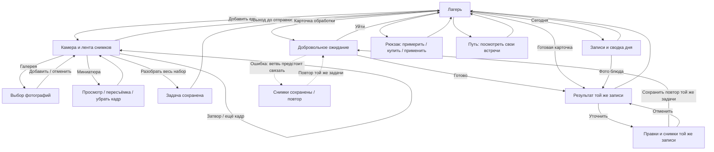

# chewy — основной сценарий прототипа

> Актуальная схема на 28 октября 2026; история прежних потоков — в архиве.
> Правила и открытые решения — [DESIGN](DESIGN.md), наличие состояний —
> [SCREEN_STUDIES](SCREEN_STUDIES.md), порядок завершения — [TODO](TODO.md).
> Ниже разделены работающее демо, ожидаемое поведение и вопросы; это не итоговое согласование.

## Начало и смысл сессии

Вход сразу в лагерь. Первый и повторный заход различаются данными, а не онбордингом.
Онбординг, имя, запрос уведомлений и пейвол исключены из текущей приёмки.
Пользователь может посмотреть мир и записи, ничего не добавляя и не покупая.

Основной путь: **лагерь → фото → «Разобрать» → лагерь → результат → лагерь**.
Дополнительно: «Сегодня» → выбранная запись → уточнение; рюкзак → примерка/покупка/
применение → лагерь; путь → просмотр → лагерь. Полученный эффект еды и причина
вернуться выбираются в Q1–Q2; сейчас связаны разбор и визуальный отклик зоны.

## Добавление: что именно уже сохранено

| Момент | Действие и выход | Данные |
|---|---|---|
| Камера без фото | Снять, открыть галерею, раскрыть детали, вернуться в лагерь | Записи и награды ещё нет |
| Набор снимков | Затвор добавляет кадр в ленту; можно снять ещё. Миниатюра открывает необязательный просмотр/пересъёмку/удаление | Один черновик одной еды, не запись за каждый кадр |
| Галерея | Выбрать кадры и добавить в тот же набор; отмена возвращает без добавления | Неотправленный набор остаётся в текущем экране |
| Детали | Необязательные порция и заметка; закрытие возвращает к фото | Детали не обязательны для отправки |
| «Разобрать» | Сохранить весь набор одной задачей и перейти в лагерь | После подтверждения задача и снимки должны пережить закрытие/перезапуск |
| Обработка | Открыть карточку из лагеря, посмотреть снимки/детали или сразу выйти | Выход не отменяет задачу; ждать на экране не нужно |
| Готовность | Открыть готовую карточку или запись из «Сегодня» | Полученный результат доступен независимо от просмотра |

До «Разобрать» текущая проба не сохраняет черновик при перезагрузке. Нельзя обещать
«фото уже сохранено» после одного затвора. Приёмка должна проверить явный выход
из несохранённого набора; необходимость подтверждения потери относится к Q3.

В существующем демо готовность определяется сохранённым временем завершения.
Это воспроизводит возвращение, но не запускает фоновый AI-запрос.

## Результат, дневник и уточнение

На результате первыми видны фото, название, короткая оценка и четыре запаса.
Оценка и каждый запас раскрывают пояснение по нажатию; открыта одна подробность.
Есть доступ к дополнительным снимкам. «Уточнить» и «В лагерь» доступны постоянно.

Уточнение редактирует ту же запись: название, порцию, детали и снимки. Пока повтор
не закончен, дневник сохраняет прежний завершённый результат. Отмена правок не
трогает запись. Успешный повтор заменяет её оценку; ещё один приём не создаётся.
Ошибка повтора должна оставлять прежний результат и возможность повторить запрос
с сохранёнными правками; детали поведения завершаются решением Q3.

«Сегодня» раскрывается из лагеря: сводка по добавленной еде, запасы, фотографии
со временем и названием. Фото открывает конкретную запись. Пустой день предлагает
добавить еду. Закрытие возвращает в лагерь, фокус — к действию «Сегодня».

Первый выход из нового результата сейчас показывает короткий отклик зоны лагеря.
Повторный просмотр не повторяет его в той же сессии. Это не реализованный рост
и не сохранённая выдача награды; целевое поведение событий определяется Q1–Q2.

## Связи экранов

Пунктир означает пробел текущей реализации, а не необязательную ветвь готового core.
Не-еда и низкая уверенность описаны ниже; их отдельные макеты ещё нужно привязать
к исходу конкретной сохранённой задачи.

## Возвращение и вещи

После перезапуска должен открываться лагерь с сохранёнными задачами, записями,
выбранным прогрессом и вещами. Сегодняшние записи относятся к своему календарному
дню. Новый день начинает пустую дневную сводку, не отменяя постоянные достижения.
Результат вчерашней задачи не становится сегодняшней едой. Место доступа к нему
и правила при смене часового пояса нужно выбрать в Q3.

В рюкзаке: выбрать предмет → увидеть примерку → купить при достаточном балансе →
применить. Купленная вещь остаётся доступной после замены. Автоприменение, число
слотов и связь базовых предметов с развитием — Q4. Нехватка монет оставляет просмотр
и выход; приложение не требует дополнительной еды ради покупки.

Путь показывает прошлые встречи и текущую стоянку. Просмотр другого участка не
перемещает героя. Движение героя и изменение окружения должны следовать выбранному
правилу Q5; сейчас это ручная демонстрация. Ночь сейчас меняет свет, полноценное
поведение героя во сне ещё не собрано (Q6).

## Состояния для приёмки

Это ожидаемое покрытие готового прототипа, не перечень уже работающих функций.
Связанные продуктовые выборы сначала закрываются в DESIGN.

| ID | Проверяемый проход | Что должно быть понятно / сохранено |
|---|---|---|
| F1 | Чистая сессия → первая еда → результат → лагерь | Нет выдуманной истории; первая польза и выбранная реакция/награда видны |
| F2 | Два фото одной еды → сохранить → уйти → перезагрузить | Одна задача, оба кадра, возвращение к ожиданию/результату без дубля |
| F3 | Ещё одна еда → «Сегодня» → первая запись | Обе записи различимы; сводка соответствует текущему дню, результат выбранной записи узнаваем |
| F4 | Уточнить готовую запись → отменить; затем отправить и завершить | Отмена сохраняет исходное; ожидание не стирает прежний результат; успех заменяет ту же запись |
| F5 | Нет доступа к камере → галерея / выход; отмена галереи; выход из черновика | Доступен работающий выход, нет ложного подтверждения сохранения |
| F6 | Нет сети / ошибка / долго нет ответа → уход/перезапуск → повтор | Снимки той же задачи сохранены; повтор не создаёт вторую запись или награду |
| F7 | Не-еда и поздняя не-еда | Нет подтверждённой записи еды/монет; понятный исход и другое фото. Судьба учёта дня — Q3 |
| F8 | Низкая уверенность / неизвестное масло → уточнение | Неизвестное явно обозначено; известный вклад не обесценен; уточнение не дублирует запись |
| F9 | Задача вчера → ответ сегодня; новый день / смена зоны | Правильный день еды, доступ к позднему ответу, сохранённый постоянный прогресс — по Q3 |
| F10 | Повторный просмотр результата / несколько готовых задач | Просмотр не начисляет заново; задачи различимы; нет обязательной очереди сценок |
| F11 | Удаление записи / отмена ожидающей задачи | Подтверждение, последствия и возврат соответствуют Q3, накопленный рост не отзывается |
| F12 | Рюкзак: хватает/не хватает → купить → применить → сменить → перезапуск | Баланс, владение и применение согласованы; применение каждой вещи видно в соответствующем экране (декор/питомец — лагерь, тема — анализ) |
| F13 | Путь → осмотр другой стоянки → лагерь; следующий выбранный шаг | Просмотр не телепортирует; прогресс связан с общей сессией по Q5 |
| F14 | Возврат после перерыва / ночь / новая еда | Герой не ухудшается от еды; ночные часы не создают деградацию; вещи/рекорд сохраняются |

Матрица SCREEN_STUDIES хранит состояние покрытия и после приёмки — подтверждение
проходов. Сервисные события, необходимые native (сохранено, готово, ошибка, повтор,
смена дня), описываются здесь по результатам этапа 2; старый Swift-ответ с ккал/БЖУ
не становится контрактом автоматически.
