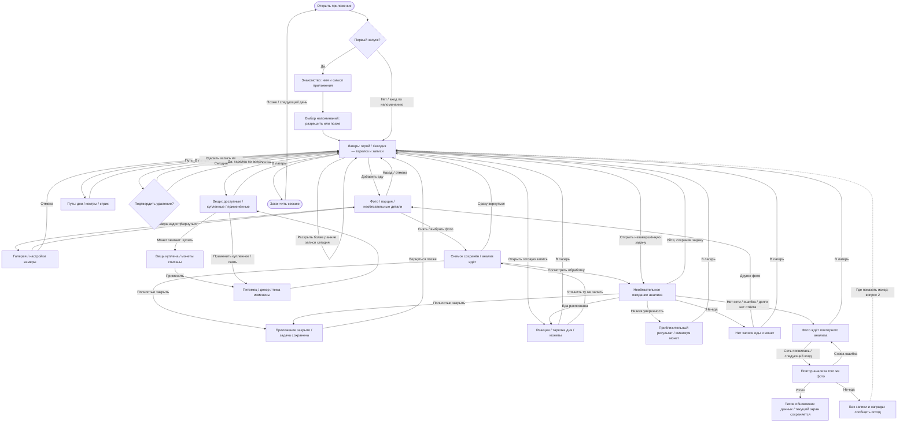

# Прототип до аудита 28 октября 2026

> Исторический снимок документов до упорядочивания. Не текущие правила и не очередь.
> Текущий маршрут: [MVP_PLAN](../MVP_PLAN.md), задачи: [TODO](../TODO.md).
> Исходная ревизия: f8816ee. Сохранены прежние предложения, тюнинг и планы после прототипа.


---

## Исходный MVP_PLAN.md

# chewy — план возвращения

> Порядок уточнён владельцем 2026-10-25. Текущий шаг и статус — в [TODO.md](../TODO.md).

## Рабочий порядок

| Шаг | Что делаем | Готово, когда |
|---|---|---|
| 1. Черновой канвас | Экран за экраном набросать композицию, крупные блоки и примерный вид | Есть общее понимание, как будут выглядеть экраны и какой контент для них нужен |
| 2. Генерация контента | По черновикам экранов подготовить изображения, анимации и другие нужные материалы | Контент готов к сборке экранов; требования уточняем по примеркам |
| 3. Storybook с контентом — сейчас | Собрать связанный прототип с подготовленными материалами, довести внешний вид и проверить сценарии | Полный прототип выглядит как задумано, проходится кликами и согласован с владельцем |
| 4. Нативное приложение | Перенести согласованный прототип в iOS, подключить камеру, анализ, сохранение, уведомления и аналитику; подготовить TestFlight | Основные сценарии работают на iPhone, прогресс сохраняется, можно начать валидацию |

Канвасы всех экранов и первые примеры с контентом собраны в Storybook.
Сейчас проверяем и обсуждаем полный набор: [SCREEN_STUDIES](../SCREEN_STUDIES.md).
Артефакты этапов 1–2 готовы для примерки; согласование внешнего вида ещё впереди.
Документы и [USER_FLOW](../USER_FLOW.md) помогают обсуждать экраны по ходу работы;
открытые продуктовые вопросы фиксируем и согласуем до реализации соответствующей логики.
Камеру, Gemini, уведомления и сеть до iOS моделируем; доступы к сервисам не блокируют
продуктовое ревью и прототип. Бенчмарк Gemini остаётся перед реализацией приложения.

Начинаем с экранов кора: лагерь → добавление еды → результат → обновлённый лагерь →
покупка/применение. В раннем прототипе вход сразу в лагерь. После рабочего кора
возвращаемся к онбордингу, имени и предложению напоминаний; они остаются в Сборке 1
и входят в ревью полного прототипа до iOS.

По уточнению владельца от 2026-10-17 ревью кора ведём на отдельном грубом скелете
Storybook, параллельно текстовым сценариям. Скелет не означает согласования спорных
правил; детали добавляем после просмотра экранов. Существующий прототип сохраняем в `prototype/archive/legacy-prototype/`; в рабочей
песочнице оставлены скелет и повторяющая его секция канваса в Storybook.

Текущая проба от 2026-10-24: в скелете пять экранов; журнал дня перенесён в секцию
«Сегодня» под героем в лагере. Тарелка и последние записи рядом, более ранние записи
дня раскрываются на месте. Компоновка остаётся черновой; ревью ещё не завершено.

Текущий шаг от 2026-10-25: по цели владельца готовы канвасы и Sandbox-примеры
15 экранов/состояний, включая рюкзак, путь, знакомство и проблемные исходы.
Камера занимает весь экран; снимок сохраняется сразу, ожидание добровольное,
результат можно уточнить. Рюкзак позволяет примерить, купить и применить вещь;
путь сохраняет прошлые встречи. Добавлены фото и предметы для примерки.
Следующий шаг — ревью новых экранов с владельцем, затем полировка полного прототипа.

## Какие документы открывать

- **Сейчас:** этот план → [USER_FLOW.md](../USER_FLOW.md); текущие задачи — [TODO.md](../TODO.md).
- **Правила продукта:** [DESIGN.md](../DESIGN.md); причины решений — [DECISIONS.md](../DECISIONS.md).
- **По необходимости:** [ASSETS.md](../ASSETS.md) для медиа; [VALIDATION.md](../VALIDATION.md) для беты.
- **История:** [SPEC v5](../archive/spec/SPEC_v5.md) и [старый бэклог](../archive/AGENT_BACKLOG.md).
  Это инженерные заготовки, которые потребуется сверить с согласованным прототипом.
  Версии спеки v1–v4 — в Git; для текущей работы не нужны.

Механики Сборки 1, инварианты и пороги валидации не меняются. Новые идеи — в IDEAS
в TODO. После каждой сессии обновляем текущий статус и один следующий шаг;
коммиты и пуши — только по явной команде.


---

## Исходный TODO.md

# chewy — задачи

> Порядок этапов и карта документов — [MVP_PLAN.md](../MVP_PLAN.md).
> Единственная текущая очередь. Механики Сборки 1 заморожены; новые идеи — в IDEAS.

## Карта направлений · 2026-10-27

Ориентир для обсуждения очередности, не пять параллельных очередей реализации.
Текущий этап — Storybook; новые гипотезы ниже остаются в IDEAS до ревью.

| Направление | Что предстоит определить | От чего зависит |
|---|---|---|
| Питание и оценка | Подтверждённый вклад блюда в четыре запаса, неопределённость, сводка дня и смысл завершения цели | ВОЗ / Гарвардская тарелка, ограничения фотоанализа; игровые пороги пока открыты |
| Игровая прогрессия | Что делает Чуви, что остаётся в лагере, что относится к дню; связь запасов с монетами, магазином и биомами | Понятные вклады из первой ветви; правила наград требуют ревью |
| Пользовательский сценарий | Первая польза, быстрый снимок и уход, возвращение за результатом, уточнение и проблемные исходы | Прогрессию можно примерять на явно условном примере |
| Арт и движение | Сценки героя, стадии предметов, раскрытие результата и отклик завершения | Сначала выбрать действие и его смысл, затем готовить соответствующие ассеты |
| Нативная реализация | Камера, анализ, очередь, сохранение, уведомления и проверка на iPhone | Согласованный полный прототип; бенчмарк и план Сборки 1 ниже |

Владелец согласовал проработку одного примера «блюдо → подтверждённые вклады
→ действие Чуви → сохраняющееся изменение → что человек увидит при возвращении».
Подготовлен [сценарий скамейки у костра](../NUTRITION_HABITS.md#сценарная-проба-скамейка-у-костра--27-октября-2026):
частичное строительство, завершение, уточнение той же записи, новый день и магазин.
Следующий шаг — ревью причинной связи; затем одна проба в текущем Storybook.
Выбран порядок проработки; конкретные правила и награды остаются предложениями.

## NEXT — ревью полного набора экранов

- [x] Дать владельцу управление списками для ревью (28 октября): в Storybook
      «Экраны → Удалить эту страницу», в песочнице «Удалить экран из списка»;
      восстановление в обоих местах и локальное сохранение между перезагрузками.
      Проверены полная очистка и возврат 51 страницы / 15 экранов. Исходный набор
      после проверки восстановлен; это два независимых списка, переходы приложения
      и данные еды сохраняются. [Инструкция](../../prototype/README.md#как-убрать-лишние-страницы-и-экраны).

- [x] Собрать walkthrough текущего прототипа: два фото → сохранение в лагере →
      обработка → готовый разбор → пояснение к запасу → возвращение в лагерь.
      28 секунд, реальные кадры Storybook; ожидание сокращено при монтаже.
      [Видео MP4](../exports/chewy-walkthrough-2026-10-27.mp4) ·
      [GIF-превью](../exports/chewy-walkthrough-2026-10-27.gif).

- [x] Связать снимок, карточку задачи в лагере и результат короткими переходами
      по обсуждению эмоционального дизайна: фото летит в ленту, карточка узнаётся
      по снимку и времени, открытие сохраняет визуальную связь. Проверены два
      быстрых снимка, галерея, три размера, уточнение и возврат из результата.
      Reduced motion учтён в коде; анимация не задерживает сохранение.

- [x] Пересобрать обработку по ревью владельца: крупный отправленный снимок,
      прибор над едой, один понятный статус, миниатюры и детали по запросу.
      Проверены три размера, три темы, несколько фото, выход в лагерь,
      новый набор кадров при уточнении и автоматическое завершение анализа.
      [Превью для ревью](../exports/chewy-processing-photo-2026-10-27.png).

- [x] Пройти полный сценарий через интерфейс: два фото → сохранение → уход
      и возврат после перезагрузки → результат → лагерь → «Сегодня».
      Одна новая запись, оба кадра сохранены; повторный просмотр не дублирует
      отклик. [Прогон и кадры](../exports/food-flow-review-2026-10-27.md).
      Обработка пересобрана; уведомление теперь показывает фото и время записи.

- [x] Собрать «Сегодня» в стиле принятого результата: четыре предметных запаса,
      короткая оценка по нажатию и лента фотографий. Убрать постоянные пояснения
      и повторные оценки блюд; проверить пустой день и переход к результату.
      Проверены три размера, раскрытие одной подробности, лента, пустой день,
      неизвестный состав, переход к блюду и камере, закрытие с возвратом фокуса.
      [Превью для ревью](../exports/chewy-today-quiet-2026-10-27.png).

- [x] Примерить предметные метафоры на результате: материалы, дрова, фонарь,
      семена рядом с названиями питания; пояснение только по нажатию. Добавить
      короткий визуальный отклик зоны при первом возврате из готового результата.
      Это проба связи еды и лагеря, без выдачи предметов и новых правил роста.
      Проверены три размера, четыре зоны, неизвестный состав и отсутствие
      повторного отклика у просмотренной записи. Владелец принял вариант.

- [x] Сократить текст результата по ревью владельца: показывать объяснение
      оценки и каждого запаса только по нажатию, сохранив доступ к уточнению.
      Проверены раскрытие одной подробности, сворачивание и возврат фокуса.

- [x] Собрать компактный результат анализа как страницу походного дневника:
      фото и вывод сверху, четыре запаса 2×2, заметное уточнение. Проверить
      маленький экран, неизвестный состав и повторный запрос в текущую запись.
      Проверены три размера, несколько фото, Canvas и Sandbox. Следующий шаг —
      ревью этой композиции владельцем.

- [x] Добавить ленту снимков над затвором по уточнению от 2026-10-27:
      после снимка оставаться в камере, открывать просмотр по миниатюре,
      отправлять весь набор одной кнопкой. Проверены Canvas и Sandbox,
      три размера и уточнение записи. Владелец принял экран как рабочий вариант;
      по запросу убраны пояснения и подписи под иконками. Следующий шаг — ревью
      обработки и результата с уточнением.

- [x] Переработать добавление еды по уточнению владельца: открытая камера,
      просмотр и пересъёмка, несколько фото одной записи, необязательные детали,
      повторный анализ с сохранением прежнего результата. Собрано в Canvas и Sandbox;
      дополнительный просмотр заменяем необязательным открытием снимка из ленты.

- [x] Перенести одобренную раскладку начального/обжитого лагеря в Canvas и Sandbox:
      уменьшенный герой, четыре постоянные зоны, независимые действия внизу;
      переключение стадии в инспекторе и проверка трёх размеров.

- [ ] Примерить четыре заполняемых запаса героя: белок, углеводы с клетчаткой,
      ненасыщенные жиры, овощи и фрукты. Проверить названия, дневную сводку и вклад
      отдельного блюда. Наполнение пока демонстрационное; пороги и награды открыты.
      По запросу владельца раскрыта метафора обустройства, топлива, света и сада
      в NUTRITION_HABITS; следующий предмет обсуждения — действие Чуви после еды.
      Для ревью размещения показаны [начальный и обжитый лагерь](../exports/chewy-camp-growth-v1-2026-10-26.png).
- [x] Собрать пробу запасов в существующих Сегодня / результате и компактном
      дневнике лагеря, сохранив неопределённость состава и замену уточнённой записи.

- [ ] Примерить обновлённое «Сегодня» и результат с оценкой состава и качества еды
      по ВОЗ и Гарвардской тарелке. Без вялого героя; конкретные формулировки
      и данные оценки пока демонстрационные.
- [x] Собрать эту пробу в существующих историях Sandbox: сводка дня, разбор блюда,
      неизвестный состав, уточнение и пустой день. Переключение примеров — в инспекторе.

- [x] Подчистить список Sandbox по запросу владельца от 2026-10-26: убрать
      CompactPhone, LargePhone, Gallery, EmptyBackpack, FirstPath и ReturnPath.
      Основные рюкзак и путь, связанные экраны и переключатели пробы сохранены.

- [x] По решению владельца исключить вялость героя из-за еды: убрать отрицательные
      реакции и реплики из общей логики прототипа, правил и плана ассетов.

- [x] Расширить одобренную пробу дороги до девяти биомов: новые участки карты
      и соответствующие лагеря, сохранив время суток и демопереключение стоянок.
      [Шесть новых мест](../exports/chewy-new-biomes-route-and-camp-2026-10-25.png).

- [x] Новая визуальная проба по уточнению владельца: прокручиваемая дорога сверху,
      три биома, смена окружения лагеря при продвижении и время суток. Правила
      прогрессии пока демонстрационные, описание — DESIGN «Визуальная проба дороги».
      [Дорога и лагеря на одной картинке](../exports/chewy-journey-world-2026-10-25.png).

Цель владельца от 2026-10-25 выполнена: канвасы всех экранов и примеры с контентом
собраны в Storybook. Композиция, референсы Haven / Focus Friend, покрытие и проверки —
в [SCREEN_STUDIES.md](../SCREEN_STUDIES.md). Это черновики для ревью, не согласование финального арта.

- [x] Убрать дубли документов и сохранить прежний прототип в архиве.
- [x] Собрать грубый каркас `Core/Skeleton`.
- [x] Набросать 15 экранов/состояний в `Core/Canvas` → «Все экраны · связанная проба».
      Лагерь и дневник оставлены владельцем как рабочая версия; камера, ожидание
      и редактируемый результат — просмотренный рабочий черновик.
      Добавлены галерея, рюкзак с примеркой/покупкой/применением, путь, знакомство,
      имя, напоминания и четыре проблемных состояния. Принцип каждого экрана виден в инспекторе.
- [x] Подготовить контент и собрать соответствующие примеры в `Core/Sandbox` →
      «Все экраны · с контентом»: исходный герой, плоская сцена, фото еды, предметы и три темы анализа.
- [x] По запросу владельца стилизовать камеру: походная лаборатория, алхимия и
      карманный сканер; три размера, заметка и быстрый снимок проверены. Проба для ревью —
      [сравнение камер](../exports/chewy-camera-styles-2026-10-25.png).
- [x] По следующему уточнению усилить стиль лагеря на остальных экранах:
      рисованные предметы камеры, сцена ожидания с героем, бумажные галерея и результат,
      общие материалы рюкзака, пути, знакомства и состояний. Проверены 13 экранов
      на трёх размерах. [Текущая визуальная проба](../exports/chewy-camp-style-screens-2026-10-25.png).
- [x] Проверить размещение на 320 × 568, 390 × 844 и 430 × 932;
      пройти сохранение снимка после перезагрузки, уточнение без дубля,
      покупку/применение, выбор темы, возвращение и добровольные напоминания.
- [ ] Вместе с владельцем просмотреть новый рюкзак, путь, знакомство и состояния;
      выбрать, какие композиции и изображения дорабатываем. Это следующий шаг.
- [ ] Согласовать вопросы из [USER_FLOW.md](../USER_FLOW.md): удаление/тарелка/награды,
      поздний результат «не-еда», количество активного декора и питомцев.
- [ ] Внести принятые решения в DESIGN / USER_FLOW / DECISIONS, довести полный
      прототип до согласования и только затем переходить к iOS.

Редактор композиции лагеря сохранён: три блочные пробы, независимые «Сегодня» и
«+ Еда», перетаскивание/масштабирование, сохранения по размерам. Отдельно доступна
[раскладка владельца](../references/camp-layout-2026-10-24.png). В новых примерах режим
редактирования выключен, чтобы проходить сценарии кликами.

Камера, сеть, AI, уведомления и покупки моделируются. Демоочередь снимков сохраняется
локально; инвентарь в новой примерке живёт до перезагрузки. Одна активная вещь каждого
типа и цены старого демо — условности проверки интерфейса, не новые правила продукта.

## После прототипа — Сборка 1

Это сохранённый объём реализации, не текущая очередь. Конкретные задачи уточняем
по согласованному прототипу; старые критерии — в [архивном бэклоге](../archive/AGENT_BACKLOG.md).

1. **Бенчмарк:** готовым скриптом проверить ~30 своих фото, включая смешанные блюда;
   при misread-rate >20% пересмотреть анализ до реализации приложения.
2. **Телеметрия первой из кода:** TelemetryDeck, события и параметры из [VALIDATION](../VALIDATION.md).
3. **Стейт:** SwiftData-лог, границы дня/таймзоны, тарелка дня, скоринг, монеты,
   стрик-уголёк и рекорд, анти-фарм; персистентная очередь фото и повтор после ошибок.
   Тюнинг перенести из DESIGN в `GameConfig.swift`, затем убрать таблицу из документа.
4. **Анализ:** пропорции, цельность, `is_food`, `confidence`; Mock для всех веток;
   не-еда, низкая уверенность, ошибка сети, удаление записи — по согласованному сценарию.
5. **Экраны и записи дня:** лагерь, анализ, результат, путь, рюкзак; размещение журнала
   и тарелки дня — по ревью пробы «Сегодня» в лагере;
   покупка/экипировка декора, питомцев и тем; каталог по объёму и ценам из DESIGN.
6. **Привязанность:** имя, мини-онбординг, шаблонная речь без AI, добровольные локальные
   пуши с quiet hours; реакции героя, костёр и питомцы по [ASSETS](../ASSETS.md).
   Полировка существующих экранов — таймбокс около двух дней на экран.
7. **Проверки:** сборка/CI; сохранение после перезапуска, смена дня и таймзоны,
   переходы стрика, примеры скоринга из DESIGN, повтор очереди, отсутствие дублей
   наград и покупок, расписание пушей; сценарии на iPhone.

## Бета и публичный релиз

- [ ] Драфт privacy policy RU/EN: фото → Gemini, телеметрия, без аккаунтов; до внешней беты.
- [ ] Подготовить TikTok-клипы и набор когорты; объём, окно и метрики — в VALIDATION.
- [ ] Провести TestFlight-валидацию по замороженным правилам VALIDATION.
- [ ] До публичного релиза выбрать имя: chewy рабочее; прежний поиск коллизий — в DECISIONS.
      Подготовить шорт-лист, повторно проверить App Store, домены и товарные знаки.
- [ ] До публичного релиза: прокси Gemini-ключа (Cloudflare Worker), подпись запросов,
      rate limit, инструкция деплоя.
- [ ] По необходимости: разбор Finch, Ate и тёзки Chewy — цикл, онбординг, пуши,
      монетизация и отзывы. Это исследование из прежнего бэклога, не блокер прототипа.

## IDEAS / После сигнала

### Завершение целей и возвращение · обсуждение 2026-10-27

Владелец уточнил: из Apple Rings интересна механика завершения, а не обязательная
форма колец. Ранее показанные кольца — только визуальная примерка; редизайн
«Сегодня» под них не выбран. Ниже сохранены гипотезы для проработки, не утверждённые
механики Сборки 1. Сценарные вопросы использовать при текущем ревью прототипа.

- [x] Проработать [один пример «Скамейка у костра»](../NUTRITION_HABITS.md#сценарная-проба-скамейка-у-костра--27-октября-2026):
      обед с нутом и овощами → вклад → начало работы → завершение в последующие
      подходящие дни → сохранённая вещь при возвращении. Описаны неизвестное масло,
      исправление, повтор, удаление и разделение с магазином. Подготовлена
      интерактивная схема для обсуждения; это проработка, не реализованный рост.
- [x] Зафиксировать направление владельца: сначала развитие наполняет лагерь,
      позже кастомизация раскрывает возможность сделать его своим. Порядок
      описан в DESIGN и NUTRITION_HABITS; условия открытия ещё не выбраны.
- [ ] Примерить переход от развития к кастомизации на знакомой вещи: скамейка
      появляется и используется → первый выбор оформления → более широкий выбор.
      Определить понятную веху, не объявляя по ней привычку сформированной.
- [ ] Провести ревью примера: завершение дела между днями, участие дня вместо
      количества логов, сохранение вещей после исправления, базовая вещь / оформление.
      Затем примерить согласованное поведение в Storybook. Длительность и формула
      роста, пересмотр монет и остальные занятия остаются открытыми.
- [ ] Определить небольшой цикл «понятная цель → заметный вклад → завершение
      → следующий цикл». Решить, что означает «собрано» для запасов и какой период
      показываем. Форма индикатора вторична; игровые ориентиры не выдавать за
      подтверждённые персональные нормы питания. Частичный вклад имеет смысл;
      дополнять еду ради заполнения всех шкал не требуется.
- [ ] Развить существующую идею автоматических занятий Чуви и следов в биомах:
      примерить один предмет в состояниях «задуман → строится → готов» и короткий
      отклик на вклад. Разделить дневную сводку и постоянное обустройство;
      накопленный мир сохраняется после смены дня и перерыва. Отдельно согласовать
      условия событий, повтор/уточнение без дублирования прогресса и соседство
      с монетами и магазином. Основа — [NUTRITION_HABITS](../NUTRITION_HABITS.md).
- [ ] Проработать первый и повторный заход как одну историю: первая еда даёт
      понятный разбор и видимый отклик; снимки сохраняются до ухода; при возвращении
      узнаётся готовая запись, видны результат и его связь с лагерем. Выбрать
      конкретную пользу, ради которой хочется вернуться, и показать следующий
      небольшой шаг. Знакомство с приложением должно дать попробовать эту пользу.
- [ ] Примерить короткое раскрытие результата и приятное завершение действия:
      пользователь сразу получает доступ к разбору, движение можно пропустить,
      результат и изменения доступны при позднем возвращении. Вариативные сценки,
      звук и haptic — отдельные кандидаты после выбора сценария; случайный размер
      награды и обязательная «распаковка» не выбраны.
- [ ] Позже оценить Live Activity как дополнение к уже запланированным уведомлениям
      о готовности: только реальные состояния обработки, без выдуманных процентов
      и этапов. Нативная интеграция не входит в текущую примерку Storybook.

Референсы: [Apple Activity Rings](https://www.apple.com/watch/close-your-rings/),
[Tim Gabe — геймификация](https://www.youtube.com/watch?v=LXX_qOA5D8E)
(завершение, освоение и умеренность механик),
[Tim Gabe — второй заход](https://www.youtube.com/watch?v=YA3QpYIKqNI)
(первая польза, фоновые действия и готовый результат),
[Tim Gabe — эмоциональный дизайн](https://www.youtube.com/watch?v=Du2lkZ_cux8).
Это источники для гипотез; конкретные адаптации выше предложены для Чуви.

### Остальные идеи

- [ ] Косметика для разных планов лагеря: гамак, чайник. Проверяем
      боксами в канвасе по просьбе владельца; в каталог и экономику Сборки 1
      не добавлены. Гамак пробуем вместо отклонённой гирлянды. Дополнительные
      походные идеи: свёрнутый спальник, фляга, верёвка, карта на пне; пока без
      реализации. Типы предметов и одновременная установка ещё не согласованы.

- [ ] Варианты сценического отображения сегодняшней еды: пикник перед героем, гирлянда
      снимков, раскрытый походный дневник, тропинка дня, миниатюры вокруг общей тарелки.
      Дневник оставлен владельцем как рабочая проба главного экрана; остальные варианты пока
      на уровне идей. Герой остаётся главным, новая запись заметна,
      сегодняшний день понятен и отдельные приёмы доступны для просмотра.
- [ ] Просьбы героя, вылазки/находки, рост кемпа, одежда, деградация за молчание и виджет
      — смысл и ограничения в DESIGN «Отложенные механики».
- [ ] Монетизация — открытая гипотеза в DESIGN.
- [ ] Биомы пути: новые ландшафты привязать к суммарным дням логирования, не к стрику;
      прогресс не отнимается. В прототипе есть демо с тизером следующего биома.
- [x] Подготовить [предложение о привычках и биомах](../NUTRITION_HABITS.md)
      на основе ВОЗ, NHS, Canada Food Guide и NICE: девять тем, примеры действий,
      ограничения фотоанализа и вопросы к прежнему скорингу.
- [x] Владелец одобрил направление привычек, меняющих мир, и исключил вялость
      героя из-за еды. Прежний расчёт монет пока требует отдельного пересмотра.
- [ ] Выбрать детали истории для следующего канваса: луг → овощи к обычному
      обеду → цветы и сувенир. Конкретные задания и награды ещё не согласованы;
      логики привычек в Storybook и iOS пока нет.
- [ ] Vacation mode (отпуск/болезнь), недельные квесты, мультиплеер, Apple Watch.
- [ ] Порции как зелья Sip/Draft/Elixir; карта дня как путь еды.
- [ ] История по дням, профиль, haptic, звуки; RPG-статы — только при наличии применения (Tier 3).
- [ ] ComfyUI + ControlNet для спрайтов; прочие предложения прежней спеки — архив §16.

## Уже есть — заготовки

- iOS: камера, лагерь и Gemini-анализ по старой схеме; сохранения приёмов ещё нет.
- Рабочая песочница: три секции Storybook — скелет кора, канвас боксами
  и отдельная проба аппликации лагеря `Core/Sandbox`.
  Прежние экраны, компоненты, истории, паки A–C и скрипты временно убраны в
  [архив прототипа](../../prototype/archive/legacy-prototype/README.md); файлы сохранены.
  Общие демоданные оставлены для работы скелета. Запуск — [prototype/README](../../prototype/README.md).
- Бенчмарк-скрипт: три пробных результата сохранены; полноценная проверка на своих фото впереди.

## WON'T DO

Смерть/game over; изменение тела героя; вес и цифры питания пользователя; наказание
за джанк; продажа заморозки стрика. Причины — в [DECISIONS.md](../DECISIONS.md), инварианты
— в [AGENTS.md](../../AGENTS.md). Уголёк остаётся бесплатным и автоматическим.


---

## Исходный USER_FLOW.md

# chewy — сценарий и граф использования


> Актуальная проба добавления от 2026-10-27: **камера + лента снимков →
> «Разобрать» → лагерь**. Затвор добавляет фото в ленту над кнопками съёмки,
> камера остаётся открытой для следующего кадра. Несколько фото считаются одной записью;
> миниатюра открывает необязательный просмотр с пересъёмкой и удалением.
> Галерея добавляет выбранные фото в ту же ленту.
> Порция и заметка раскрываются по желанию. На результате «Уточнить результат»
> открывает поля и снимки; повтор заменяет ту же запись, сохраняя прежний результат
> до завершения. По уточнению владельца обязательный просмотр после затвора убран.
> Исторический сценарий ниже описывает прежнюю немедленную отправку после затвора.
> Гарантия возвращения к анализу начинается после подтверждения сохранения.
> Несохранённый набор снимков и отменённые правки в этой пробе не переживают перезагрузку.

> Результат от 2026-10-27: страница дневника с фото, названием и кратким выводом
> сверху, четыре запаса сеткой 2×2 ниже. Несколько фото и подробности раскрываются
> по желанию. Внизу всегда доступны «Уточнить» и «В лагерь»; уточнение использует
> прежнюю форму и повторно анализирует ту же запись.

> После ревью текст скрыт до запроса: нажатие на короткую оценку раскрывает её
> причину и совет, на запас — его источник и пояснение шкалы. Открыта одна
> подробность; повторное нажатие или крестик сворачивает её.


> Черновик для обсуждения с владельцем от 2026-10-14; рабочий порядок — в [MVP_PLAN.md](../MVP_PLAN.md).
> Сценарий ещё **не согласован**. По уточнению от 2026-10-25 сейчас экран за экраном набрасываем примерный вид на канвасе; затем генерируем контент и собираем с ним прототип в Storybook.
> Действие пользователя: **«Добавить еду»**. Русские подписи ниже — рабочий язык
> обсуждения; финальный язык приложения пока не выбран.

> Порядок работы от 2026-10-17: сейчас ревью основного цикла с прямым входом в лагерь.
> Онбординг, имя и предложение напоминаний — после рабочего кора в Storybook.
> Сценарий первого знакомства ниже сохранён как отложенный черновик; граф показывает
> целевое приложение, а ранний прототип начинается с узла «Лагерь».

> Проба от 2026-10-24: в `Core/Skeleton` журнал дня объединён с лагерем. Герой сверху,
> ниже «Сегодня»: тарелка, последние записи и раскрытие более ранних записей сегодня.
> Сценарий и граф ниже отражают эту компоновку для ревью; окончательно она не согласована.
> Добавление еды и результат остаются отдельными экранами; прежний прототип сохранён.

> Проба от 2026-10-25: `Core/Canvas` → «Сегодня · походный дневник». Вместо текстовой
> области — мини-страница с тарелкой и последними добавлениями. Нажатие раскрывает её
> в сегодняшние записи, закрытие возвращает на место. Это отдельная демонстрация метафоры
> и перехода; выбор оформления и связь с полным циклом добавления еды ещё впереди.

> Следующее уточнение от 2026-10-25: главный экран с дневником оставляем как рабочую
> версию и переходим к канвасу добавления еды. По дальнейшим уточнениям владельца камера
> занимает весь экран; можно добавить детали заранее, быстро снять и полностью закрыть
> приложение. Результат доступен при возвращении и допускает уточнения того же снимка.
> Камера, галерея и анализ пока подставляют пример; демонстрационная задача переживает
> перезагрузку браузера. Это моделирует сценарий, а не гарантирует фоновый запрос в iOS.

## Зачем человек открывает приложение

Человек добавляет фото своего приёма пищи, видит реакцию знакомого героя и получает
монеты. За день складывается понятная картинка питания без подсчёта калорий.
Заработанные монеты позволяют выбрать питомца, украсить лагерь или сменить оформление
анализа. Причина вернуться — увидеть героя, добавить следующую еду и постепенно
обустроить своё место. Смотреть лагерь и покупки можно без обязательного нового фото.

**Цикл:** лагерь → «Добавить еду» → реакция и результат → обновлённый лагерь →
«Сегодня» в лагере / путь / покупка → выход → возвращение к следующему приёму пищи.

## На что уже договорились опираться

Правила — из [DESIGN.md](../DESIGN.md), [DECISIONS.md](../DECISIONS.md) и текущего скоупа
[TODO.md](../TODO.md). Детали [архивной SPEC v5](../archive/spec/SPEC_v5.md) и существующий Storybook — материал
для проверки; расхождения ниже не превращаются автоматически в решения.

- Нет калорий, БЖУ, веса и процентов питания. Числа допустимы для монет, цен и стрика;
  время записи помогает узнать приём пищи. Тарелка дня показывается секторами.
- Герой — друг: не умирает, не стыдит, тело не меняет. Любая записанная еда учитывается;
  состав еды и размер порции не вызывают вялость или реплики о переедании.
- За запись еды есть минимум монет; бонус зависит от вклада в незаполненные сектора
  дня. Полная тарелка и лимит бонусов не запрещают добавлять еду дальше.
- Низкая уверенность анализа: запись, приблизительная тарелка, минимум монет.
  Не-еда: без записи еды и монет; новое правило награды за такую попытку не вводим.
- Новый день начинает новую тарелку и журнал. Монеты, покупки и рекорд сохраняются.
  Один полностью пропущенный день приостанавливает стрик; два подряд прерывают текущую
  цепочку. Сегодня без записи ещё не считается пропущенным днём.
- Ошибка сети не должна уничтожать фото или стрик. Награда ждёт результата анализа.
- В Сборке 1: декор, питомцы, темы анализа; добровольные напоминания. Одежда, квесты,
  вылазки, биомы, развитие построек, платные функции и история журнала по дням отложены.
- Пороги, события и методика [VALIDATION.md](../VALIDATION.md) остаются прежними.
  Переименование пользовательского действия не переименовывает событие `feed`.

## Три основных сценария

### Первый запуск — черновик для ревью после готового кора

1. Человек видит героя в лагере, даёт ему имя или оставляет предложенное. Аккаунт,
   параметры тела и цели по весу не нужны. Конкретное имя по умолчанию ещё выбираем.
2. Короткое знакомство объясняет цикл: фото еды → реакция → монеты → вещи для лагеря.
   Любую еду можно записать; приложение не выдаёт оценки человеку.
3. Выбор напоминаний добровольный. Только согласие вызывает системный запрос;
   отказ или «позже» ведёт дальше с теми же возможностями приложения.
4. Открывается пустой лагерь: герой, секция «Сегодня» с пустой тарелкой и без записей, начало пути.
   Нет выдуманных прошлых дней, покупок или стрика. Стартовый баланс — открытый тюнинг,
   демонстрационные монеты Storybook не считаются решением.
5. «Добавить еду» открывает фото и выбор порции. Камера запрашивается здесь, когда
   она нужна. При отказе остаются галерея и выход в лагерь.
6. Человек снимает или выбирает фото; по желанию заранее добавляет детали. Снимок
   сохраняется, можно сразу вернуться в лагерь или полностью закрыть приложение.
   Ожидание открывается по желанию. Позже результат показывает название еды,
   реакцию героя, изменение **тарелки дня** и заработанные монеты. Название, порцию
   и детали можно уточнить: повтор обновляет ту же запись. Ошибки описаны ниже.
7. «В лагерь» возвращает к уже обновлённым записи, тарелке и балансу. Реакция ещё
   ощущается в лагере; нажатие этой кнопки не является условием выдачи награды.
8. Можно открыть рюкзак, выбрать цель для будущей покупки или закончить сессию.
   Первая покупка не обязательна и не гарантируется сразу после первого фото.

**Человек понял:** как добавить еду, где увидеть результат и зачем нужны монеты.

### Обычная сессия — быстро добавить еду или посмотреть свой мир

1. Открытие ведёт в лагерь с сохранёнными вещами и сегодняшними записями.
2. Если есть новая еда: «Добавить еду» → фото и порция, необязательные детали →
   снимок сохранён → лагерь или закрытие приложения. Смотреть ожидание необязательно;
   готовый результат можно открыть позже и уточнить. Повторное нажатие и уточнение
   одного снимка не создают второй приём и вторую награду.
3. Тарелка показывает вклад в общий день; повторение уже заполненного сектора не
   увеличивает его бесконечно. Запись и минимальная награда остаются.
4. Секция «Сегодня» под героем отвечает «что я уже добавил сегодня»: тарелка и последние
   записи видны сразу, более ранние записи дня раскрываются на месте. Путь отвечает
   «как я возвращался по дням». Просмотр и раскрытие записей не меняют прогресс.
5. Если монет хватает: рюкзак → покупка → применение → лагерь с новой вещью.
   Если не хватает, можно посмотреть другие вещи и выйти; требования добавить ещё
   еды ради покупки нет. Косметика меняет оформление, не правила наград.
6. После подтверждения сохранения снимка человек может полностью закрыть приложение;
   задача и уже полученный результат сохраняются. При возвращении виден результат
   либо состояние ещё незавершённой обработки.

**Пример дня:** утром овсянка с ягодами дополняет тарелку, днём другой приём добавляет
вклад в незаполненные сектора. Вечером пицца тоже появляется в журнале и даёт минимум
монет; герой реагирует доброжелательно. Точная награда зависит
от уже заполненной тарелки и существующего тюнинга, а не от «хорошего/плохого» дня.

### Возвращение завтра — продолжить без повторного обучения

1. Вход вручную или по добровольному напоминанию ведёт в лагерь. Онбординг не повторяется.
2. Герой, вещи, баланс и рекорд на месте. Тарелка и записи в секции «Сегодня» пусты;
   вчерашний результат не должен мигать как сегодняшний. Отдельного «итога вчера» нет.
3. В пути остаются настоящие прошлые дни. Первый новый приём продолжает цепочку;
   несколько записей одного дня не добавляют несколько дней стрика.
4. После одного пропущенного дня виден тлеющий костёр и прежний счётчик; новый приём
   продолжает цепочку. После двух и более начинается новая, рекорд и покупки остаются.
5. Вчерашнее фото, ожидающее анализа, относится ко вчерашнему дню даже при ответе
   сегодня. Его награда может пополнить баланс, но не заполняет сегодняшнюю тарелку.
   Где видеть и отменять такое ожидание — вопрос 2.
6. Ночью герой отдыхает и напоминания не приходят. Добавить еду по своей инициативе
   всё равно можно. Ночные часы и тайминги реакции уточняются отдельно от графа.

## Граф использования

Сплошные стрелки — основной маршрут черновика с пробой секции «Сегодня» в лагере.
Пунктир — предлагаемое поведение, которое ещё нужно согласовать (вопрос 2).
«Отмена» ниже относится к действию **до отправки** фото; после отправки это отдельный случай.



## Выходы, пустые состояния и незавершённые действия

- **Онбординг:** SPEC предлагает после закрытия посередине начать знакомство заново;
  после завершения — всегда лагерь. Возврат к предыдущей карточке предлагаем разрешить
  без сброса имени. Это выбор навигации для ревью, а не готовая функция прототипа.
- **Пустой день:** в лагере секция «Сегодня» с пустой тарелкой и «Сегодня пока нет записей»;
  рядом доступно «Добавить еду». В пути нет фиктивной истории, в рюкзаке доступны просмотр каталога
  и возврат даже без денег. Не требуется обязательная покупка или заполненная тарелка.
- **Фото до отправки:** назад не создаёт запись, награду или день стрика. Отмена галереи
  возвращает на экран фото. Отказ в камере оставляет галерею, настройки и выход.
  SPEC предлагает отправку одним действием, без отдельного обязательного экрана проверки.
- **После отправки:** повторные нажатия не создают дубли. Подтверждение сохранения
  означает, что можно уйти с экрана или полностью закрыть приложение: снимок, задача
  и результат не теряются. Выход не равен удалению. Отмену и удаление ожидающего фото
  ещё нужно решить — вопрос 2.
- **Результат:** «В лагерь» не отправляет фото повторно. Отдельное «Уточнить анализ»
  передаёт исправленные название, порцию и детали для той же записи; пока идёт повтор,
  дневник сохраняет предыдущий результат. Из дневника можно снова открыть запись.
  Не-еда дополнительно предлагает другое фото. При низкой уверенности повтор не создаём
  автоматически: сначала показываем честный результат существующей записи.
- **Записи в «Сегодня»:** последние видны под тарелкой, более ранние записи дня
  раскрываются без перехода. Удаление требует подтверждения, «Оставить» закрывает
  его без изменений; последствия удаления остаются вопросом 1. Удаление ещё не реализовано
  в скелете. Путь открывается из лагеря и возвращает туда же. Историю прошлых дней не добавляем.
- **Рюкзак:** купить и применить — разные действия по SPEC; автоприменение покупки
  ещё не утверждено. При замене питомца/темы прежнее остаётся купленным. Снятие темы
  возвращает базовую таверну. Продажа, возврат монет и платные усиления не входят.
- **Ожидание через полночь:** дата записи — день отправки, не день ответа и не дата
  из фотографии. Сообщение об исходе должно быть доступно даже после смены дня — вопрос 2.

## Расхождения и вопросы до согласования сценариев

Это точки выбора, а не разрешение самостоятельно менять правила.

| № | Что расходится | Что нужно решить / предложение для обсуждения |
|---|---|---|
| **1. Удаление и тарелка** | SPEC §5.4 пересчитывает тарелку без удалённой записи; `ChewyApp.jsx` оставляет её заполненной. И там и там монеты и учёт дня сохраняются | **Предложение:** пересчитывать тарелку, чтобы она соответствовала журналу; не отзывать монеты, не возвращать использованный бонусный слот, не обнулять день. Нужен выбор владельца |
| **2. Ожидание, выход и повтор** | SPEC не гарантирует сохранение фото после полного закрытия до ошибки; незавершённые фото могут относиться к прошлому дню | **Владелец подтвердил 2026-10-25:** быстро снять и полностью закрыть приложение, вернуться к результату позже; добровольный просмотр ожидания, уточнения до запроса и на результате. Снимок/задача сохраняются, уточнение относится к той же записи. **Остаётся решить:** отмену/удаление ожидающего фото и последствия для дня, объяснение поздней не-еды. Камера и очередь в текущем канвасе — моки |
| **3. Сколько декора одновременно** | Прототип и SPEC используют один активный декор; SPEC §15 оставляет вопрос открытым, а каталог описывает разные места лагеря | Выбрать один заменяемый предмет или несколько одновременно. Это влияет на смысл покупок и следующий этап устройства сцены; число мест сейчас не придумываем |

**Не-еда — расхождение реализации с правилом, а не новый выбор награды.**
DESIGN/DECISIONS уже задают «без лога и монет». SPEC §5.7 при этом отмечает день
до анализа и оставляет его даже после не-еды. При переносе нельзя принять этот
побочный эффект за утверждённый способ получить прогресс. Защиту ожидающего фото
от ошибки сети нужно отличать от подтверждённой записи еды; поздний отказ анализа
и его объяснение входят в вопрос 2. Само правило не-еды повторно не согласовываем.

**Не блокируют основной граф, но требуют решения до соответствующей реализации:**
стартовые монеты и момент первой доступной покупки; пороги бонусов/уверенности,
пересмотр коэффициента цельности; тайминги и ночные часы; язык и имя героя.
SPEC и прототип используют разные формы ответа анализа и тюнинг. Этот документ
не утверждает новую схему, конкретные числа или новые состояния героя.

Прочие найденные пробелы прототипа для этапа 3: мгновенный анализ, демонстрационная
история новичка, потеря выбора напоминаний, отсутствие прямого повтора после не-еды,
бонус при низкой уверенности и неполное сохранение реакции при возврате в лагерь.
Биомы из демонстрации пути остаются идеей, не обязательным прогрессом Сборки 1.

## Как проверить и закончить этап

Сейчас пройти граф на словах: лагерь → первая еда → результат → лагерь; повторный приём → «Сегодня»;
покупка → применение → изменённый лагерь; возврат завтра и после пропуска.
В скелете проверить пробу «Сегодня»: герой остаётся сверху, записи читаются рядом
с тарелкой, раскрытие более ранних записей дня не требует отдельного экрана.
Отдельно пройти отказ в камере, отмену фото, не-еду, низкую уверенность, отсутствие
сети, повтор, закрытие во время ожидания, поздний ответ и удаление записи.

Для каждого прохода понятно: куда можно выйти, что уже сохранено, что ещё ожидается
и почему человек вернётся. Вопросы 1–3 разобраны с владельцем и внесены в решения.
Сейчас разбираем примерный вид экранов на канвасе, уточняя сценарии по мере необходимости.
Полный проход проверяем в Storybook с контентом после его генерации; спорные правила
согласуем до реализации соответствующей логики. Ревью первого знакомства возвращается после рабочего кора;
оно должно завершиться до согласования полного прототипа и перехода к iOS.
Этот черновик сам по себе согласованием не является.

### Проба связи результата и лагеря · 2026-10-27

На результате четыре предмета сопровождают понятные названия питания.
Нажатие раскрывает связь предмета с лагерем и источник в еде. Первый возврат
из готового результата показывает короткий перелёт одного предмета к зоне
лагеря. Уже просмотренная запись и неизвестный состав не запускают отклик.
Пока это только визуальный переход; новые предметы и рост не начисляются.

### Сегодня · компактная проба · 2026-10-27

Лист раскрывается из лагеря. Сверху четыре запаса и короткая оценка дня,
ниже лента фотографий еды. Запас или оценка раскрывает пояснение; фотография
открывает результат блюда. Повторное нажатие или крестик скрывает пояснение.
В пустом дне «Добавить еду» закрывает дневник и открывает камеру. Закрытие
листа возвращает в лагерь, фокус — на «Сегодня».


---

## Исходный DESIGN.md

# chewy — правила продукта и стиль

> Правила и тюнинг — здесь. Сценарии для ревью — [USER_FLOW.md](../USER_FLOW.md),
> очередь работ — [TODO.md](../TODO.md). Причины решений — [DECISIONS.md](../DECISIONS.md).

## Суть

Юзер фоткает еду → Gemini оценивает тарелку по **пропорциям** (Гарвардская тарелка:
~50% овощи/фрукты, 25% белок, 25% цельные злаки), не по калориям → герой реагирует →
юзер получает **монеты** → тратит на **косметику** (декор лагеря, питомцы, темы
экрана анализа; одежда — после сигнала). Мотивация — простые правила: больше овощей, меньше обработанной еды,
умеренная порция. Обучение через заботу о герое, не через лекции и цифры.

Ощущение продукта — **мультик, а не приложение** (референсы: Haven, Focus Friend).
Мини-игра-сервис, не диет-трекер.

## Принципы композиции экранов

### Проба обработки · 2026-10-27

Обработка привязана к отправленным снимкам: они остаются главным объектом,
небольшой инструмент движется над выбранным фото. Один постоянный статус
объясняет действие; сохранение подтверждается отдельно. Выход доступен сразу,
результат можно найти в лагере. Детали запроса раскрываются по желанию.
Проценты, обещание времени и неподтверждённые этапы анализа не показываем.
Повторный запрос использует обновлённые снимки и сохраняет старую запись до
ответа. В инспекторе фиксируется только демонстрационный экран для ревью;
задача из камеры продолжает завершаться по существующему таймеру.

### Проба предметных запасов · 2026-10-27

На результате оставляем понятные названия питания и краткую оценку состава.
Белок сопровождают материалы для обустройства, углеводы с клетчаткой — дрова,
ненасыщенные жиры — фонарь, овощи и фрукты — семена и росток. Это игровые
ассоциации; пояснение открывается по нажатию, а не занимает первый слой.

Для ревью связи с лагерем при первом выходе из готового результата предмет
коротко перемещается к соответствующей зоне. В примере выбираем наибольший
подтверждённый вклад; неизвестный состав не запускает сценку. Повторное открытие
уже просмотренной записи не запускает её снова. Инспектор позволяет повторить
любой вариант. Это временный визуальный отклик, без наград, роста лагеря,
новых предметов или сохранения очереди событий. Конкретные занятия героя и
правила долговременного обустройства ещё предстоит примерить.

### Общая композиция

Зафиксированы с владельцем 2026-10-25. Применяем уже в черновом канвасе, до генерации
контента; конкретную раскладку выбираем на примерках. Геометрия проб — в
`prototype/src/core/camp-composition-presets.js`.

1. **Один главный акцент.** В лагере первым замечаем героя, затем еду и «Добавить еду»,
   затем окружение. Переходы заметны и доступны, но не спорят с героем.
2. **Большое, среднее, маленькое.** Различаем масштабы масс. Связанные предметы собираем
   в группы: костёр и чайник воспринимаются вместе. Не расставляем всё на равных интервалах.
3. **Асимметричное равновесие.** Уравновешиваем визуальный вес, а не количество предметов.
   Треугольник «герой — костёр — пёс» — одна из проб; симметрия и правило третей не обязательны.
4. **Планы и перекрытия.** Отделяем фон, задний, средний и передний планы. Палатка позади
   героя; основания предметов и контакт с землёй поддерживают глубину.
5. **Осмысленный воздух.** Оставляем спокойный фон вокруг лица и просветы между группами.
   Распределяем пустоту по экрану, проверяя плотность нижней части и место под еду.
6. **Чистые силуэты.** Сохраняем явный просвет или уверенное перекрытие. Избегаем случайных
   касаний контуров, слипания головы с палаткой и предметов с навигацией.

Проверка: сравниваем несколько раскладок простыми серыми блоками; уменьшаем изображение
или прищуриваемся — герой и главное действие должны оставаться различимыми. Проверяем
контрольные размеры телефонов. Блоки показывают области будущего контента; читаемость
реальных силуэтов повторно проверяем после генерации. Пробы не утверждают число активных
предметов, финальный арт, цены или новую механику.

Основа: [визуальная иерархия NN/g](https://www.nngroup.com/articles/principles-visual-design/),
[баланс и движение взгляда Getty](https://www.getty.edu/education/k-12-learning/describe-listen-draw/vocabulary-for-describing-an-artwork/).

---

## Герой и мир

Герой — **мальчик-приключенец у костра** (ассеты готовы: idle-цикл, анимированный кемп).
Тело героя не меняется никогда (ED-подтекст) — всё выражают поза, энергия и мир вокруг.
Герой никогда не умирает и не упрекает. По решению владельца от 2026-10-25 еда
не вызывает вялость или реакцию на переедание: `sluggish`, `stuffed` и реплики
о тяжести исключены независимо от состава блюда и размера порции.

**Состояния — простой набор** (4 штуки, две оси):

- Потребность (таймер от кормления, **чисто визуальная** — ничего не сгорает):
  `idle` (сыт, костёр горит) → `hungry` (грустнеет, костёр тлеет). Ночью спит, таймер на паузе.
- Реакция на еду: `eating` → `happy`, затем обычное состояние лагеря.

Реализовано в коде: `idle`, `eating`, `happy`. Дорисовать: `hungry`.
Расширение после валидации (модификацией базовых): `starving`, `energized`.

---

## Кор-луп

```
фото еды → Gemini: пропорции тарелки + цельность + is_food + confidence → реакция + речь
         → МОНЕТЫ = вклад приёма в ТАРЕЛКУ ДНЯ (закрытие незакрытых секторов)
           минимум монет — за ЛЮБОЙ лог (честность; джанк логировать безопасно)
         → косметика: декор лагеря / питомцы / темы анализа (одежда — после сигнала)
```

- Стрик — за логирование (честность), не за «чистое питание».
- Полные сектора вклада не дают → дополнительные монеты за них не начисляются.
  Размер порции не вызывает отрицательную реакцию героя.
- Антипаттерн (не делать): наказание за джанк → юзер прячет джанк → лог врёт → аппка мертва.

### Скоринг: вклад в тарелку дня

- Тарелка дня — цели в юнитах по секторам (пропорции 50/25/25; значения → GameConfig).
- Приём: юниты порции × пропорции Gemini раскладываются по секторам; вклад засчитывается
  только в незакрытую часть цели. Монеты = 1 (за лог) + бонус за вклад.
- Цельность: прежний коэффициент <1 пока участвует в заполнении секторов;
  минимум монет начисляется за любой лог. Связь с вялостью героя удалена.
  Сам коэффициент остаётся отдельным вопросом пересмотра в NUTRITION_HABITS.
- Примеры: овсянка+ягоды утром — большой вклад → happy; та же овсянка третий раз — вклад мал;
  яблоко при недоборе фруктов — хороший снек; пицца вечером при полных секторах — минимум
  монет и доброжелательная реакция без оценки переедания.
- Анти-фарм: полная награда — первые N приёмов дня, дальше только минимум. Кап одинаков для
  любой еды — это не наказание джанка.
- Просьбы героя (отложены) при возврате берут эту же логику: озвучить недобранный сектор.

### Оценка еды и проба Сегодня от 2026-10-26

Владелец подтвердил: оценка питания остаётся основой продукта и учитывает одновременно
[Гарвардскую тарелку](https://nutritionsource.hsph.harvard.edu/healthy-eating-plate/)
и [рекомендации ВОЗ](https://www.who.int/news-room/fact-sheets/detail/healthy-diet).
Отказ от вялого героя не означает отказа от содержательной оценки еды.

Для канваса пробуем два слоя: состав блюда относительно тарелки и качество продуктов
(цельные злаки, бобовые, источники жиров, соль, свободные сахара). Гарвардская модель
даёт примерные пропорции овощей/фруктов, белковых продуктов и цельных злаков,
а также рекомендации по их выбору; это не суточная норма в игровых юнитах.
Картофель не заполняет овощной сектор и не считается цельным злаком.

В «Сегодня» — вывод только по добавленным записям и разбор каждого блюда.
В результате — понятная оценка состава, объяснение и одно предложение улучшения.
Перекус оценивается как вклад, без требования собрать полноценную тарелку.
Неизвестные масло, соль и сахар остаются неизвестными; редактирование не должно
сохранять уверенную оценку старого состава. Состояние героя и прежняя экономика
не меняются. Отдельные формулировки и пороги пока не утверждены.

В Storybook используются явно заданные примеры, не работающая модель анализа.
Рисунок тарелки показывает ориентир групп, не выполненную дневную норму.

### Четыре запаса героя · проба от 2026-10-26

По запросу владельца вводим видимые заполняемые шкалы: **белок**, **углеводы
с клетчаткой**, **ненасыщенные жиры**, **овощи и фрукты**. Это четыре направления
обратной связи, а не четыре равные части Гарвардской тарелки. Белковую часть
оцениваем по продуктам; качество углеводов — по цельным злакам, бобовым, овощам
и цельным фруктам; жиры — по подтверждённым источникам ненасыщенных жиров.
Один продукт может участвовать в нескольких шкалах, например нут — в белке
и углеводах с клетчаткой. Зелень входит в более широкую овощную группу.

В канвасе шкалы выглядят как запасы Чуви за сегодняшний день. В лагере остаётся
компактный знак четырёх запасов; дневник раскрывает их названия и источники.
Результат показывает прежний запас и светлый добавленный участок от блюда.
Гарвардская тарелка остаётся отдельным ориентиром состава, соль и свободные сахара —
отдельными замечаниями, а не ресурсами, которые нужно накопить.

Заполнение в Storybook задано вручную для визуальной пробы. Шкалы не измеряют
граммы нутриентов и не подтверждают выполнение персональных суточных норм.
Размер порции меняет демонстрационный вклад; предел не даёт запасу переполняться.
Уточнение заменяет вклад той же записи, неизвестный состав не получает выдуманный
вклад. Неизвестное масло не заполняет жиры; отдельный пример содержит явно
указанное оливковое масло. У каждой шкалы видны источники подтверждённого вклада.

Заполнять все шкалы ежедневно не обязательно: никаких просьб доесть ради шкалы,
штрафов, ухудшения героя или потери накопленного пути. Четыре шкалы не обещают
полную оценку здоровья рациона. Финальные пределы, веса, период оценки и связь
с развитием героя требуют отдельного согласования; экономика пока прежняя.

### Метафоры запасов · предложение от 2026-10-26

Владелец положительно оценил идею обустройства, топлива, света и сада и попросил
развить её. В [NUTRITION_HABITS](../NUTRITION_HABITS.md#еда-обживает-лагерь--развитие-метафоры-26-октября-2026)
описана проба: еда даёт видимый вклад, Чуви сам занимается лагерем, постоянные
изменения сохраняются на пути. Дневные шкалы отражают записи за сегодня, предметы
мира — накопленные события. Детальные триггеры, награды и их связь с монетами
пока предложены для обсуждения; существующий скоринг этим не изменён.

### Сценарная проба «Скамейка у костра» · 2026-10-27

Владелец согласовал следующий шаг: проработать один пример от блюда до постоянного
изменения лагеря и возвращения. Подробный сценарий и спорные случаи — в
[NUTRITION_HABITS](../NUTRITION_HABITS.md#сценарная-проба-скамейка-у-костра--27-октября-2026).
Ниже — предложение для ревью; условия роста и экономика ещё не утверждены.

- Механика завершения привязана к понятному делу Чуви: задумал скамейку → собирает
  → пользуется готовой. Дело продолжается между днями. «Сегодня» показывает вклад
  записанной еды; полная полоса не объявляет рацион достаточным или день идеальным.
- Пример: нут с овощами даёт основания показать белок, углеводы с клетчаткой,
  овощи. Вид масла остаётся неизвестным до уточнения. Для скамейки используется
  направление обустройства; одновременное заполнение остальных запасов не требуется.
- Первая еда даёт и разбор, и заметное начало работы. Последующие подходящие дни
  могут продвигать дело. Для обсуждения предлагаем засчитывать участие дня,
  а не число фото, запросов или размер порции. Длительность остаётся открытой.
- Подготовленный результат обновляет дневник и сохраняет событие лагеря; просмотр
  только показывает его. Можно уйти сразу после снимка и вернуться позже.
- Исправление заменяет сведения о еде. Одна и та же запись или день участия
  не продвигают то же дело повторно; уже сделанные вещи и этапы сохраняются.
- Предлагаемое разделение: развитие открывает базовую вещь, магазин — её оформление
  и самостоятельную косметику. Запасы не становятся платёжными валютами. Прежние
  формула монет и каталог требуют отдельной сверки; эта проба их не меняет.

Сначала проверяем эту историю и её смысл; затем примеряем её в существующем
Storybook. Встроенная визуальная схема — обсуждение состояний, без изменения
прототипа, реального начисления прогресса и новых ассетов.

Уточнение владельца: сначала развитие наполняет лагерь, затем кастомизация даёт
новый повод возвращаться, когда использование становится привычным. Принимаем
это как порядок раскрытия возможностей: **обжить → сделать своим**. Условия
открытия оформления ещё не выбраны; завершённый предмет или этап лагеря можно
примерить как понятный повод предложить первый вариант. Он не доказывает, что
привычка уже сформировалась. Новые места и занятия могут развиваться дальше,
параллельно персонализации; существующие магазин и экономика пока прежние.

### Принятая раскладка лагеря · 2026-10-26

Владелец одобрил сравнительный арт начального и обжитого лагеря и попросил перенести
его в макеты. Герой становится меньше прежнего центрального силуэта: вокруг него
остаются четыре постоянные зоны — обустройство слева у палатки, топливо внизу слева,
свет справа и сад внизу справа. «Сегодня» и «+ Еда» стоят отдельно у нижнего края.

В Canvas и Sandbox используем одну геометрию и переключаемые начальное/обжитое
состояния в существующем инспекторе. Стадия оформления задаётся для ревью независимо
от дневной еды, монет и пройденного биома. Герой и объекты остаются отдельными слоями;
сохранённые старые раскладки не подменяют новый принятый вариант. Старые композиции
остаются доступны как отдельные исторические пробы. Это принятие композиции,
не утверждение новых порогов прогресса или правил экономики.

### Анализ: ошибки и уверенность

- `is_food = false` (тролль-фото) → игровая реакция героя («это не едят!»), без лога и монет.
- Низкая `confidence` → фраза неуверенности («хм, не разгляжу…»), минимум монет, сектора
  приблизительные. Редактирование секторов — после сигнала; в Сборке 1 только удаление
  записи из лога.
- Перед реализацией iOS: бенчмарк на своих фото по TODO; Storybook до этого работает на моках.

## Прогресс

- **День**: мини-тарелка секторами (овощи/белок/злаки) заполняется от приёмов + журнал дня.
- **Долгий**: путь героя — тропа по дням, костры (горит/тлеет/потух) как heat-map,
  стрик 🔥 и рекорд. Стрик-«уголёк»: пропуск дня — костёр тлеет, стрик замирает; 2+ подряд —
  погас (рекорд остаётся навсегда). Накопленное (косметика, рекорд) назад не откатывается.
- Никаких цифр наружу, кроме стрика и монет.

---

## Экраны

Для полной примерки канвасов и контента используем [матрицу экранов](../SCREEN_STUDIES.md):
свои композиция и иерархия для каждой задачи, общий походный мир и доступные действия.
Новые варианты рюкзака, пути и знакомства — черновики для ревью по цели владельца.

Уточнения владельца от 2026-10-25 для добавления еды: камера занимает весь экран,
элементы управления поверх неё; галерея доступна. Научная лаборатория, алхимия и
компьютерный интерфейс — варианты оформления одного сценария, пока без цен и каталога.
Главный путь — быстро снять и убрать телефон. Снимок и задача должны переживать полное
закрытие приложения; при возвращении показываем результат либо продолжаем незавершённую
отправку/обработку. Просмотр тематической сцены ожидания добровольный, без фиктивного процента.
Перед запросом можно необязательно дописать детали. На результате можно уточнить название
и описание, повторно обработав тот же снимок; прежний результат сохраняется до нового,
повтор не создаёт отдельный приём. В канвасе это демонстрационная очередь, не реальный анализ.

### Переработка добавления еды · проба от 2026-10-26

Владелец попросил улучшить вид и удобство добавления, продумать повторный запрос
и несколько фото. Пробуем один набор снимков на один приём пищи: камера → просмотр
снимков → «Сохранить и разобрать» → лагерь. До отправки можно переснять или убрать
кадр, добавить ещё снимки камерой или из галереи. Порция и заметка раскрываются
по желанию; исходный экран камеры не содержит форму. После подтверждённого
сохранения можно уйти, ожидание остаётся добровольным.

Готовая запись сначала показывает результат. Действие «Уточнить» открывает
название, заметку, порцию и набор снимков; повторный анализ обновляет ту же запись.
До завершения повтора дневник показывает предыдущий результат и его снимки.
Закрытие редактора отменяет неотправленные правки. Все действия пока демонстрационные:
в камере и галерее подготовленные фото, анализ задан примером. Это проба сценария,
не утверждение лимита снимков, тарифов или новой экономики.

#### Уточнение владельца · 2026-10-27

После затвора камера остаётся открытой, а снимок попадает в горизонтальную ленту
над кнопками съёмки. Можно сразу снять следующий кадр; галерея добавляет фото
в тот же набор. Нажатие на миниатюру открывает необязательный крупный просмотр
с пересъёмкой и удалением. Кнопка «Разобрать» рядом с лентой сохраняет весь набор
одной записью и возвращает в лагерь. До её нажатия это черновик текущего экрана.
В уточнении результата та же лента возвращает изменённый набор в форму уточнения.
Материалы остаются прежними: бумажные миниатюры, латунь и тёмный фон камеры;
ленту можно прокрутить, последний добавленный кадр показывается сразу.

После примерки владелец принял камеру как рабочий вариант и попросил убрать
избыточные подписи. На обычном экране остаются заголовок, иконки, миниатюры
и «Разобрать»; подсказки о кадрировании, серии фото, названии темы и подписи
под иконками убраны. Доступные названия кнопок и сообщение о числе фото сохранены
для экранного диктора; добавленные детали отмечает точка. При пересъёмке остаётся
указание заменяемого кадра. Дальше ревью обработки и результата.

#### Результат анализа · проба от 2026-10-27

Владелец согласился примерить результат как страницу походного дневника:
фото и название блюда с кратким выводом сверху, пояснение состава, четыре запаса
компактной сеткой 2×2. Светлый участок по-прежнему обозначает вклад этой еды
в текущий день. Подробности и рекомендации остаются ниже, снимки раскрываются
по желанию. «Уточнить» и «В лагерь» доступны в одной нижней строке.
Уточнение открывает существующую форму и обновляет ту же запись; модель питания,
награды и правила расчёта этой визуальной итерацией не меняются.

Уточнение после ревью: владелец хочет читать текст только при интересе. На первом
слое результата остаются фото, название, короткая нажимаемая оценка и четыре
нажимаемых запаса. Описание состава, источники вкладов, легенда шкал и совет
раскрываются на месте по нажатию на оценку или конкретный запас. Открыта одна
подробность за раз; повторное нажатие сворачивает её. Основные действия остаются
внизу. Неопределённость сохраняется в короткой оценке, штриховке пустого запаса
и доступном названии кнопки.
На первом слое длинные названия сокращены до «Углеводы» / «Жиры»; полные
«Углеводы с клетчаткой» / «Ненасыщенные жиры» остаются в раскрытии и доступном
названии. Это сокращение подписи, состав запасов не меняется.

Сценарии и переходы — в [USER_FLOW.md](../USER_FLOW.md). Действие пользователя —
«Добавить еду». В рюкзаке одежда пока не продаётся; манекен остаётся витриной.
Темы анализа: базовая таверна, покупаемые лаборатория и магия; меняют оформление.

Проба для ревью от 2026-10-24 в `Core/Skeleton`: герой остаётся сверху, под ним
секция «Сегодня» объединяет тарелку и последние записи еды; более ранние записи
сегодня раскрываются здесь же. Отдельного перехода в журнал в скелете нет.
Это проверка компоновки, не финальное согласование; правила дневных записей прежние.

## Диегетический UI (мультик, не приложение)

- Мир всегда за UI: под-экраны — поверх размытого лагеря, не на плоской заливке.
- Хром = материал: вывески/свитки вместо заголовков, дерево/камень с ink-обводкой вместо
  системных кнопок, «назад» — предмет мира.
- Герой присутствует и реагирует на каждом экране (примеряет вещи в рюкзаке, смотрит на еду).
- Мир живой: костёр мерцает, монета звякает, облака двигаются (ambient, не только герой).

## Визуальный стиль

- Продукт-референсы: **Haven**, **Focus Friend**. Арт-референс: `docs/reference.jpg`,
  Adventure Time — cartoon, bold outlines, яркие цвета.
- Базовый сет: мальчик-приключенец + лагерь у костра (готовые ассеты, Kling → spritesheet).
- Шрифт `.rounded` bold; палитра: зелёный (home), тёмный (камера), оранжевый CTA.

---

## Монетизация (открытый вопрос — думаем)

Текущая гипотеза (решение 2026-06-12, уточняется):
- Подписка: безлимит анализов (free — 3/день).
- Косметика: премиум-паки (темы, костюмы) за деньги; базовая косметика — за заработанные монеты.
- Принцип: платить можно за «больше красоты», не за «снятие наказания» — наказаний нет.

## Тюнинг — первые значения (правит плейтест; при реализации → `GameConfig.swift`)

| Параметр | Первое значение |
|----------|-----------------|
| Цели тарелки дня | овощи/фрукты 4 · белок 2 · злаки 2 юнита (50/25/25) |
| Юниты порции (3 стопа) | small 2 · medium 3 · large 4 |
| Монеты за приём | 1 за лог + 0–2 за вклад (макс 3) |
| Коэф. цельности (processed) | вклад ×0.3–0.5; сам коэффициент требует отдельного пересмотра |
| Анти-фарм | полная награда — первые 4 приёма дня, дальше по 1 |
| Стрик | ≥1 лог/день; уголёк: 1 пропуск — замер, 2+ — погас |
| Цены косметики | ступени 5–10 / 20–40 / 60–100; заработок ~4–8/день |
| Каталог Сборки 1 | ≥18 позиций ≈ 4 недели трат (окно замера) |
| Пуши | 1–2/день, quiet hours ночью, opt-in |

---

## Отложенные механики (были в дизайне, вырезаны из кора — вернуть при нужде)

- **Вылазки/находки**: таймер 2–4 ч после кормления → находка по дроп-таблице → коллекция.
  Возвратный луп Focus Friend. Заменено прямыми монетами — проще. Вернуть, если возвратов мало.
- **Просьбы героя**: пустой сектор тарелки дня → «найди мне зелёного» (rule-based, без AI),
  выполнение = бонус. Скоринг уже считает недоборы секторов — просьбы = озвучить их.
- **Деградация за молчание** (только днём, quiet hours — герой спит) + виджет. Вторая
  ступень возврата; базовые локальные пуши уже в коре Сборки 1.
- **Одежда героя**: каждый костюм = перерендер стейтов × кадры анимации. Технику
  (слои vs перерендер) решить после сигнала; в Сборке 1 косметика = декор + питомцы + темы.
- **Рост кемпа**: костёр → палатка → домик на дереве — длинная прогрессия.

## Открытые вопросы

### Визуальная проба дороги и биомов · 2026-10-25

По запросу владельца в Storybook пробуем большую вертикально прокручиваемую
дорогу с видом сверху: лес, озёрный берег, золотая роща. По следующему запросу
владельца расширяем пробу до девяти биомов: добавляем цветущий луг, грибной лес,
морское побережье, красный каньон, горную долину и снежный перевал. Текущая стоянка на
дороге определяет окружение главного лагеря. Время суток меняет свет сцены:
утро, день, вечер и ночь. В инспекторе доступны ручной выбор и режим текущего
времени (часовой пояс этой пробы — Europe/London).

Продвижение пока задаётся демонстрационным переключателем стоянки и кнопкой
следующего шага в инспекторе. Просмотр других мест не перемещает лагерь.
Биомы остаются направлением развития; точное число записей/дней до перехода
не утверждено. Сохраняем ранее записанный принцип суммарных дней логирования,
а не непрерывного стрика, без отката накопленного пути. Это проверка визуала
и связи экранов, не добавление новой экономики в нативную Сборку 1.

- [ ] Монетизация: подписка vs премиум-косметика vs обе; что именно в премиуме.
- [ ] Детали привычек и биомов: уточнить
      [предложение по ВОЗ, NHS, Canada Food Guide и NICE](../NUTRITION_HABITS.md).
      Владелец 2026-10-25 одобрил направление привычек, оставляющих след в мире,
      и исключил вялость героя из-за еды. Конкретные задания, награды и пересмотр
      прежнего скоринга остаются открытыми.
- [ ] Финальное название — к публичному релизу; chewy остаётся рабочим (TestFlight ок).
      Наружу chewy блокируют Chewy Inc и тёзка «Chewy — AI Calorie Counter»; Chompy занят.

---

## Реализация

SwiftUI + SpriteKit; `HeroView` — точка входа визуала героя, `AppState` — общий стейт
через `.environmentObject`. Детали прежнего проекта — в [архивной спеке](../archive/spec/SPEC_v5.md).


### Проба связанных действий · 2026-10-27

После обсуждения ролика Tim Gabe об эмоциональном дизайне пробуем короткую
цепочку «снимок → карточка в лагере → результат → отклик запасов». Сохранение
и управление не ждут анимацию. Научная/алхимическая/компьютерная тема не меняет
поведение. Карточка показывает отправленное фото и время записи; сохранение
отдельно от статуса обработки. При уточнении — текущий отправленный набор.
При нескольких задачах сохраняется прежний порядок показа: сначала последняя
ожидающая внимания, после просмотра следующая; фото и время различают записи.
Движения сокращаются при системном reduced motion. Финальные действия героя,
рост лагеря и награды этой визуальной пробой не утверждаются.
