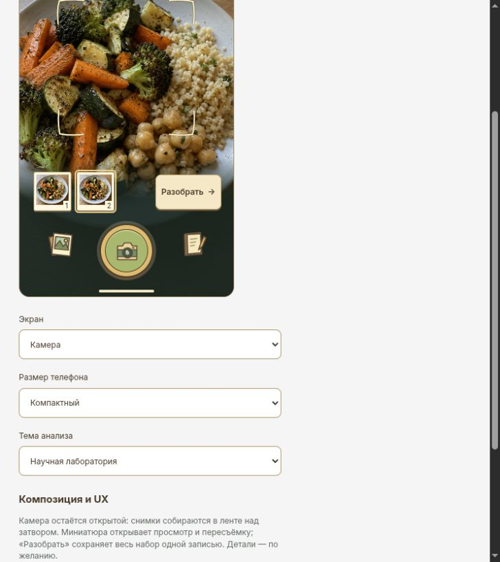
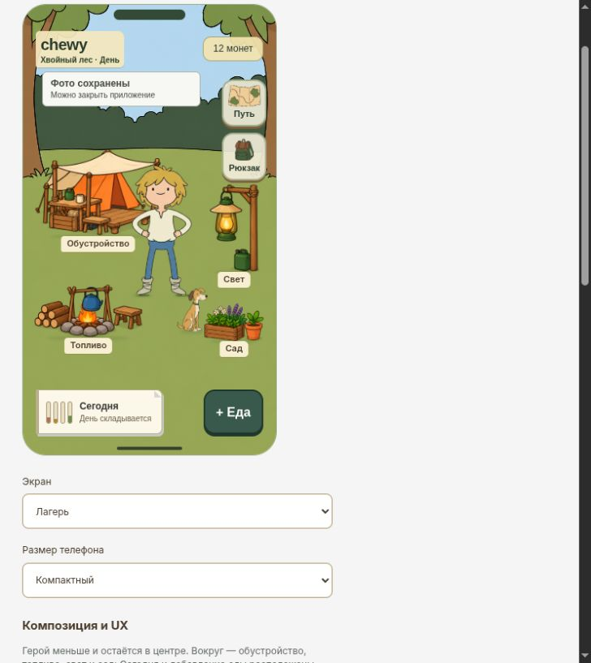
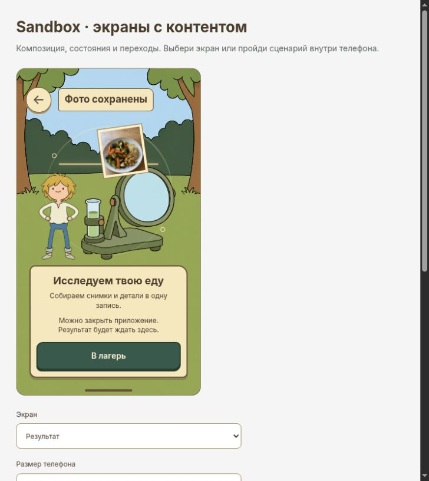
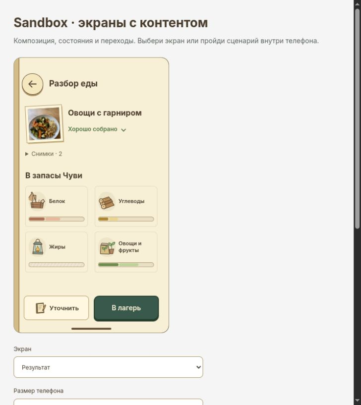
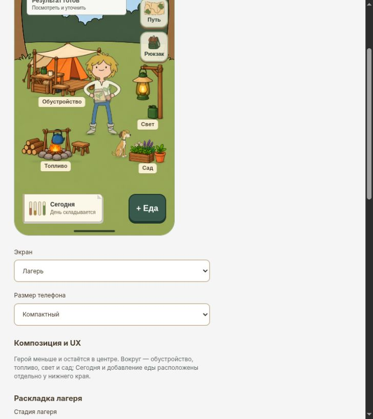
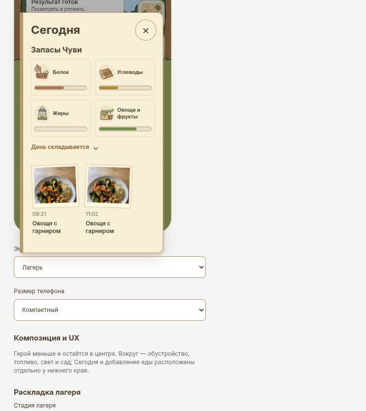

# Сквозной прогон еды · 2026-10-27

Пройден через интерфейс текущего Sandbox, без переключения на готовый пример
результата. Камера и анализ демонстрационные; проверены экраны, сохранение
записи и переходы. Продуктовый код в этом прогоне не менялся.

## Результат

| Шаг | Наблюдение | Проверка |
| --- | --- | --- |
| Камера | Два нажатия на затвор, оба кадра в ленте; камера остаётся открытой | Пройдено |
| Разобрать | Оба кадра отправлены одной записью; сразу открыт лагерь с «Фото сохранены» | Пройдено |
| Ожидание | Обработку можно открыть из лагеря, видна возможность уйти | Пройдено |
| Возврат | Страница перезагружена после сохранения во время обработки; в лагере доступен готовый результат | Пройдено |
| Результат | «Хорошо собрано», вклад в запасы, «Снимки · 2»; второй кадр выбирается | Пройдено |
| Лагерь | Первый возврат показывает предмет для сада | Пройдено |
| Сегодня | До прогона одна запись в 09:21, после — две; новая в 11:02 | Пройдено |
| Повторное открытие | Новая запись снова содержит два кадра; повторного отклика лагеря нет | Пройдено |

Перезагрузка проверяет сохранение браузерного демо и восстановление его таймера,
а не реальную фоновую работу iOS/сервера. После перезагрузки история Camera
начинается с камеры по своему стартовому параметру; сохранённый результат
доступен через возврат в лагерь. Нативный запуск пока не проверяется.

## Что стоит примерить следующим

1. **Сократить ожидание.** В сравнении с принятыми результатом и «Сегодня»
   здесь ещё большой текстовый блок: объяснение обработки и две строки про
   возможность закрыть приложение. Можно оставить короткий статус и выход,
   а ощущение процесса передать движением лаборатории.
2. **Привязать уведомление к еде.** После просмотра новой записи «Результат
   готов» остаётся, потому что есть другой старый непросмотренный разбор.
   Это проверено через интерфейс: он содержит три снимка и «Нужны детали»,
   тогда как новая запись — два снимка и «Хорошо собрано». Без миниатюры
   блок выглядит как повторное уведомление о только что просмотренной еде.
   Предложение: миниатюра, при необходимости время или количество результатов.

Эти два пункта — наблюдения для следующего ревью, изменения не внедрены.

## Кадры прогона

### Два снимка в буфере

### Сохранено, можно уйти

### Обработка

### Результат после перезагрузки

### Возвращение в лагерь

### Запись в Сегодня

Отдельно: [другой непросмотренный результат](chewy-flow-other-ready-2026-10-27.png).
